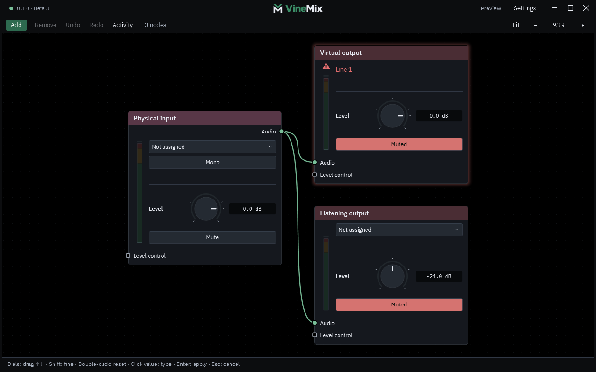

# VineMix

VineMix is an audio mixer for **Windows 11 x64**. Connect a microphone or an app to
headphones and a virtual microphone by drawing cables between nodes. Add effects
when you need them; each output has its own level and mute.

**0.3.0 · Beta 3** is an MIT-licensed open-source beta.
Download the [Windows installer](https://github.com/acoyeen/vine-mix/releases/download/v0.3.0-beta.3/VineMix-0.3.0-beta.3-Setup-x64.exe)
or [standalone EXE](https://github.com/acoyeen/vine-mix/releases/download/v0.3.0-beta.3/VineMix-0.3.0-beta.3-Standalone-x64.exe).
The [release page](https://github.com/acoyeen/vine-mix/releases/tag/v0.3.0-beta.3)
includes checksums, matching source and release notes.
See [the current qualification results](docs/BETA_TESTING_CURRENT.md),
[the beta test guide](docs/BETA_TESTER_GUIDE.md) and [testing status](TESTING.md)
for current limitations.


The screenshot uses a silent, simulated workspace. “Example USB Microphone” and
“Example Headphones” are placeholders; device names on your computer will differ.

## Get started

Choose a download from the release page:

- **Setup** installs VineMix and shortcuts for your Windows account. It can offer
  optional virtual audio drivers when missing. Both driver boxes start clear;
  install the app first unless you need those routing features. Accept their
  separate terms only if they fit your use.
- **Standalone EXE** needs no app installation. Open the supplied EXE in File
  Explorer; its bundled app files are prepared automatically. Install optional
  virtual audio drivers separately if you need them.

The app includes its .NET runtime. Driver installation can require administrator
permission and a Windows restart. The current app and Setup are unsigned; verify
the file's checksum against the matching release checksum. A signature on a third-party driver
installer does not sign VineMix.

1. Open VineMix from its shortcut, or open the standalone EXE in File Explorer.
2. In **Physical input**, choose your microphone. In **Listening output**, choose
   headphones. The starter contains these two nodes plus **Virtual output**, with
   the microphone already connected to both outputs.
3. Both outputs start **muted**; Listening output starts at **−24 dB**. Start with
   low headphone volume. Unmute Listening output when you are ready to listen,
   then adjust it gradually. Headphones help avoid microphone feedback.
4. To send the mix to a chat or recording app, install a suitable VAC driver,
   wait for Virtual output to connect to **Line 1 (Virtual Audio Cable)**, then
   select the **Line 1** recording device as that app's microphone. Unmute Virtual
   output when ready. Its mute is separate from your headphone mute.

The starter is shown below before you select any devices:



Physical microphone and headphone routes work without virtual audio drivers.
For a **Virtual Desktop microphone**, connect the headset, enable its microphone
passthrough, and check **Windows Settings → System → Sound → Input**. Select that
Windows microphone in VineMix's **Physical input** node. Existing virtual or
streamed microphones do not require the bundled cables. See
[device troubleshooting](docs/DEVICE_VISIBILITY.md) if it is missing.

[VB-CABLE](https://vb-audio.com/Cable/) is used for a virtual input:
apps play to **CABLE Input**, which VineMix receives from **CABLE Output**.
[VAC](https://vac.muzychenko.net/en/download.htm) supplies the virtual output:
VineMix sends to **Line 1** playback and other apps record from **Line 1**.
**VAC Lite is limited to private home use without income generation**; see its
[licence](https://vac.muzychenko.net/en/license.txt). The app's MIT licence does
not change driver terms. Driver information was checked on 21 October 2026.

## Everyday use

- Use **Add** to create another input, effect or output. Drag from one audio
  socket to another to connect them. Green cables carry audio; lavender cables
  are Ducking triggers.
- The wheel zooms the workspace, middle-drag pans, and **Home** fits everything.
  **Ctrl+Z** undoes an edit; **Ctrl+F** finds a node. **F1** opens Help & shortcuts.
- Changes save automatically. Wait for **Saved** before quitting. Closing the
  window keeps audio running in the tray; **Quit VineMix** in the tray menu stops
  the app and audio engine.
- Red device text means a selected device is unavailable. Reconnect it, check
  Windows sound settings, then use **Settings → Retry assigned devices**.
  **Restart audio engine** briefly interrupts audio and reconnects saved routes.
- For a report, open **Settings → About VineMix** and copy the full version
  information. Follow the [beta test guide](docs/BETA_TESTER_GUIDE.md).
- **Settings → Check for updates** checks public GitHub releases. When a verified
  update is available, choose **Download update**, then **Install and restart**.
  Audio pauses for installation. Automatic checks can be switched off in Settings;
  they never install without your choice. If checking fails, retry later or use
  the GitHub release page for a manual update.

Settings, backups and logs live in `%LOCALAPPDATA%\VineMix`. An upgrade from the
older AudioMixer name copies your existing workspace and preferences and keeps
the originals. If conflicting old copies exist, choose the workspace you intend
to use. If a workspace cannot load, a recovery banner offers Retry, Restore
backup or Start fresh while preserving originals. See
[recovery and updates](docs/BETA_TESTER_GUIDE.md#recovery).

## More information

- [Beta installation, updates, recovery and reports](docs/BETA_TESTER_GUIDE.md)
- [User guide and controls](docs/USER_GUIDE.md)
- [Application audio capture](docs/APP_AUDIO.md)
- [Device visibility and recovery](docs/DEVICE_VISIBILITY.md)
- [Effects and limitations](docs/EFFECTS_RESEARCH.md)
- [Development ideas](docs/IDEAS.md)
- [Changelog](CHANGELOG.md), [testing](TESTING.md) and [contributing](CONTRIBUTING.md)
- [Third-party credits](THIRD_PARTY_NOTICES.md) and [distribution conditions](docs/DISTRIBUTION.md)

VineMix supports up to 32 nodes and 96 connections, including 24 node types in
the creation menu. Processing stays local. Per-app capture copies an app's
playback; its original playback remains audible. Parallel paths have no automatic
latency compensation. The limiter handles sample peaks without lookahead or
true-peak detection. Audible recovery and long sessions still need qualification.

## Build from source

Developers need Windows 11 x64 and PowerShell 7. The first build downloads pinned
project-local tools and dependencies:

```powershell
pwsh -File .\scripts\build.ps1
```

The staged application is under `artifacts\VineMix-<version>-Installed`. To keep an existing package
separate, use `-PackageDirectory` with a new directory. See the
[installer guide](installer/README.md) for Setup and distribution requirements.
Generated build caches and raw verification evidence default to
`%LOCALAPPDATA%\VineMix.BuildCache`, outside the checkout.

```powershell
pwsh -File .\scripts\verify-offline.ps1
```

Offline checks use synthetic audio, simulated devices and temporary data; they do
not establish hardware or audible reliability. The release package excludes the
verification executable. The [MIT licence](LICENSE) covers the original app;
third-party components retain their own licences and notices.
