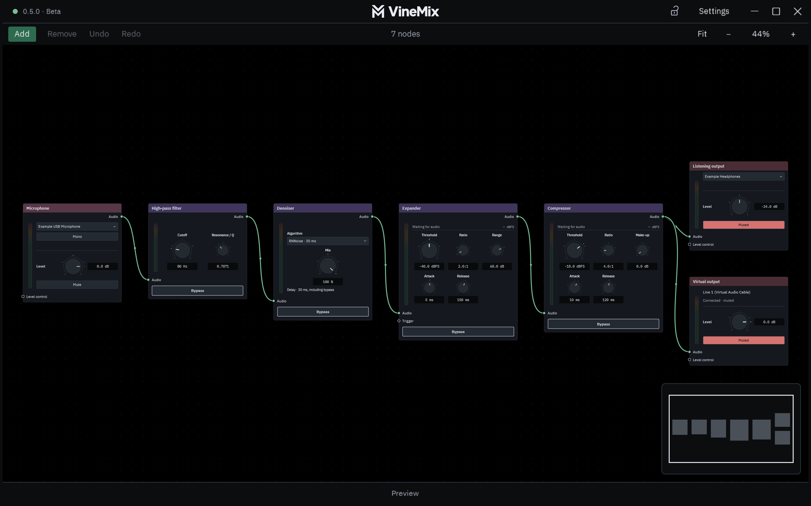
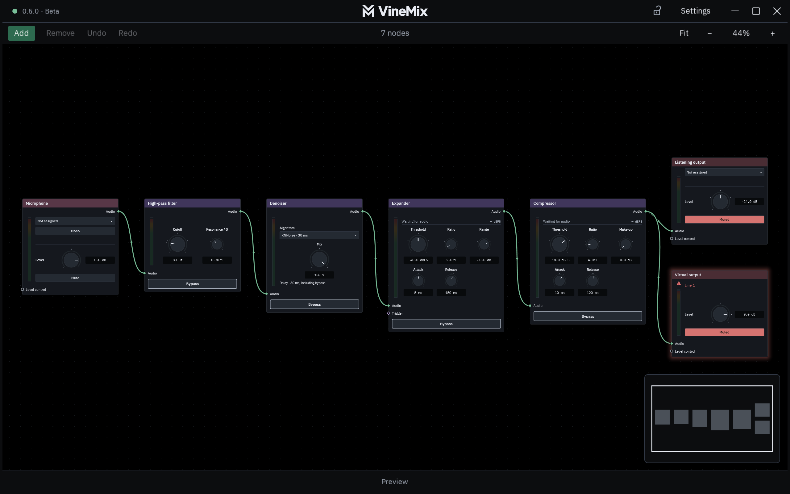

# VineMix

**Your audio, connected.** VineMix is a free, open-source audio mixer for
Windows 11 x64. Connect microphones, apps and effects with cables, then send
your mix to headphones, a recording app or a virtual microphone.

**[Download 0.5.0 Beta](https://github.com/acoyeen/vine-mix/releases/tag/v0.5.0-beta)**
· [Setup](https://github.com/acoyeen/vine-mix/releases/download/v0.5.0-beta/VineMix-0.5.0-beta-Setup-x64.exe)
· [Standalone EXE](https://github.com/acoyeen/vine-mix/releases/download/v0.5.0-beta/VineMix-0.5.0-beta-Standalone-x64.exe)
· [What's new](docs/releases/0.5.0-beta.md)



*Actual app controls rendered with silent example devices. Your device names will differ.*

## Make a mix that fits you

- **Build your own signal path.** Capture a microphone, a running app or a
  virtual cable. Branch, combine and process audio with 32 node types.
- **Shape your sound.** Clean up speech, adjust tone and dynamics, or add
  Reverb, Echo and Distortion. Separate effect outputs let you process a tail
  without changing the original voice.
- **Control each destination.** Send different mixes to headphones and other
  apps, with independent levels and mute. Multiple output nodes can share a device.
- **Keep bigger graphs manageable.** Groups, Find, keyboard navigation, Undo/Redo
  and an optional minimap help you move around. Zooming out simplifies the nodes.

Audio processing runs locally. VineMix supports up to 32 nodes and 96 connections.

## Get started

1. Install **Setup**, or open the **Standalone EXE** in File Explorer. Both
   include the required .NET runtime.
2. Choose your microphone on **Microphone** and headphones on **Listening output**.
3. Both outputs start muted. Start with low headphone volume, then unmute
   Listening output when ready and adjust its Level gradually.
4. For a virtual microphone, use a compatible Virtual Audio Cable driver. Once
   **Virtual output** is connected to **Line 1**, choose its recording endpoint
   as the microphone in your chat or recording app, then unmute that output.

New workspaces start with this connected voice chain:

**Microphone → High-pass filter → Denoiser → Expander → Compressor → Outputs**

The defaults are a starting point—adjust them for your voice. Existing workspaces
keep their nodes, levels and devices when you update.



Physical microphone and headphone routes need no virtual audio driver. Setup
offers missing optional drivers with separate consent; clear any you do not need.
Driver terms differ from VineMix's MIT licence, including VAC Lite's usage limits.
See [installation and drivers](docs/INSTALLATION_AND_UPDATES.md).

## A few useful controls

| Action | Control |
| --- | --- |
| Add or connect nodes | **Add**, then drag between sockets |
| Zoom / fit the graph | Mouse wheel or **Ctrl++ / Ctrl+−** / **Home** |
| Pan | Middle-drag, or arrows with canvas focus and nothing selected |
| Move selected nodes | Arrow keys; **Shift** for smaller steps |
| Follow a pipeline | **Ctrl+Tab / Ctrl+Shift+Tab** |
| Move between controls | **Tab / Shift+Tab** |
| Enter an exact dial value | Focus the dial and type; **Enter** applies |
| Find / rename | **Ctrl+F** / **F2** with one node or group selected |
| Undo / redo | **Ctrl+Z / Ctrl+Y** |
| Help | **F1** |

Changes save automatically. Closing the window keeps audio running in the tray;
use **Quit VineMix** in Settings or the tray menu to stop it.
**Settings → Check for updates** offers verified downloads and an explicit
**Install and restart** action. Updating briefly pauses audio.

## About this beta

The app and Setup are not Windows Authenticode signed. Checksums and signed
update metadata are included on the release page. Automated checks cover
processing, editing, recovery and packages; hardware, long-session and broader
accessibility testing remain incomplete. See the
[0.5.0 qualification record](docs/RELEASE_0.5.0_QUALIFICATION.md).

Per-app capture also leaves the app's original playback audible. Parallel paths
have no automatic delay compensation, and Distortion uses more processing time
than most effects. Many neural denoisers can also exceed the audio processing
budget; 32 nodes is the routing capacity, not a performance guarantee.
[Known issues](docs/KNOWN_ISSUES.md) records the details.

## Learn more

- [User guide](docs/USER_GUIDE.md) and [installation, updates and recovery](docs/BETA_TESTER_GUIDE.md)
- [Device troubleshooting](docs/DEVICE_VISIBILITY.md) and [application capture](docs/APP_AUDIO.md)
- [Changelog](CHANGELOG.md), [testing](TESTING.md) and [contributing](CONTRIBUTING.md)
- [Third-party notices](THIRD_PARTY_NOTICES.md) and [distribution conditions](docs/DISTRIBUTION.md)

## Build from source

Use Windows 11 x64 and PowerShell 7. Clone the `vine-mix` repository, then run:

```powershell
pwsh -File .\scripts\build.ps1
pwsh -File .\scripts\verify-offline.ps1
```

The first build downloads pinned local tools. The app is staged under
`artifacts\VineMix-<version>-Installed`; generated caches and raw test evidence
stay outside the checkout. Offline tests use synthetic audio and temporary data.
See the [installer guide](installer/README.md) for packaging.

VineMix is [MIT licensed](LICENSE). Forks are welcome; preserve its licence
notice and third-party notices. Please also credit **“Based on VineMix by acoyeen”**
in your app, with a link to [vinemix.app](https://vinemix.app).
[Attribution guidance](ATTRIBUTION.md) explains the required notices and requested acknowledgement.
