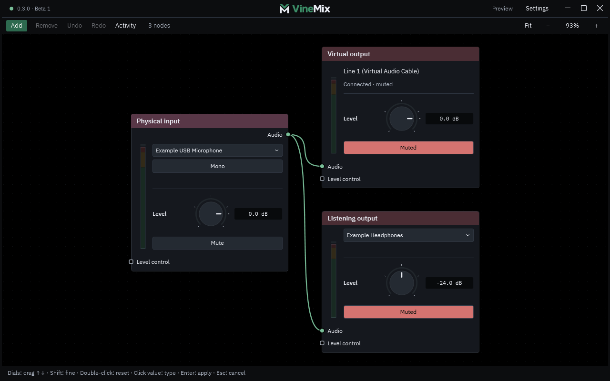
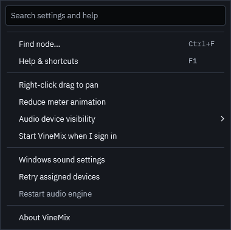

# Vine Mix visual identity

Implemented 20 October 2026. The approved direction is a minimal native audio
workspace using the split VM mark, IBM Plex typography and forest-green actions.
See the [implementation plan and evidence](BRANDING_IMPLEMENTATION_PLAN.md).

## Mark and assets

The symbol consists of a separate V above an M. Their long diagonals share a
45-degree angle; a visible gap separates the pieces. Small corner radii soften
the shape. The application caption pairs the symbol with the approved outlined
**VineMix** wordmark: green **Vine**, light **Mix**, with full-width square i dots
aligned to the capital letters and shorter i stems.
Retain **Vine Mix** in Windows titles, accessible identity and tray commands.

The caption centres the 106 × 20 DIP wide artwork across the full visible header,
with equal space above and below. Its transparent 122 × 20 DIP button leaves the
surrounding caption available for dragging and the native resize border clear.
The button supports keyboard focus and opens
[vinemix.app](https://vinemix.app), with the accessible name **Open Vine Mix
website**. The lettering comes from the packaged vector, so it needs no font
fallback and retains the approved custom letter shapes.

The website mark stays transparent on hover and press, without a tooltip,
underline or mouse highlight. Its accessible name remains available. A separate
outline appears for keyboard navigation and follows the live theme.

An 8 × 8 DIP connection dot sits at the far left, vertically centred in the same
header. Green means the interface is connected to the audio engine and ready to
accept edits; it dims during disconnection or restart. Its hover text and
accessible name expose the current connection status. Warnings occupy the left
half; saved status, Settings and window actions occupy the right without shifting
the central mark.

- [Scalable transparent mark](../desktop/AudioMixer.Desktop/Assets/Branding/mark.svg)
- [Scalable transparent wide logo](../desktop/AudioMixer.Desktop/Assets/Branding/wordmark.svg)
- [Application icon](../desktop/AudioMixer.Desktop/Assets/Branding/app.ico)
- [Tray icon](../desktop/AudioMixer.Desktop/Assets/Branding/tray.ico)
- [256px icon preview](../desktop/AudioMixer.Desktop/Assets/Branding/app.png)

Icons contain 16, 20, 24, 32, 40, 48, 64, 128 and 256px frames. Their backgrounds
are transparent; only the green V and white M are painted, including in the
taskbar, executable/window icon and tray. Shortcuts using the default application
icon inherit this artwork. The smallest frames use the brighter established
green for optical clarity. Recreate the standalone mark and icons with
`scripts/generate-brand-assets.ps1`; keep its paths synchronized with the native
vector in `Controls/BrandMark.cs`. The wide wordmark is maintained separately in
`wordmark.svg` and drawn by `Controls/BrandWordmark.cs`.

## Typography and colour

Use bundled IBM Plex Sans Regular, Medium and SemiBold for labels, node titles,
menus, search, help and tooltips. Use IBM Plex Mono Regular for exact numeric
entries, detector readouts and menu shortcuts. Keep native symbol fonts for
window/expander glyphs and normal Unicode fallback for user-provided names.
Fonts are process-local; no system installation is required. Source, hashes and
OFL terms are in [font provenance](IBM_PLEX_FONTS.md).

Menu checkmarks use drawn strokes in the shared menu template instead of a font
character, keeping their shape consistent across Settings and other menus.

| Role | Normal palette | Meaning |
| --- | --- | --- |
| Mark accent | `#3B8C66` | Forest-green identity |
| Primary action / active Mono | `#2D6A4F` | Deliberate interaction |
| Primary action text | `#F5F8F6` | Readable light label |
| Primary action hover | `#347B5B` | Hover feedback |
| Window / panels | `#0C0D0F` / `#15181E` | Quiet working surfaces |
| Text / secondary text | `#E8EBF2` / `#A5ADBA` | Information hierarchy |
| Audio cable / socket | `#78BE98` | Audible audio route |
| Sidechain cable / diamond socket | `#B8A0D8` | Ducking detector only |
| Control cable / square socket | `#A0A8B3` | Control connection |

Retain distinct muted category headers, explicit Mute/Bypass labels and
green/amber/red meter zones. Do not reuse brand green for warnings or replace
the sidechain role with audio green. High contrast replaces operational colours
with Windows system colours through dynamic resources.

Each menu root owns one help popup for its rows and nested menus. Moving between
rows updates the explanation; entering or leaving a submenu clears the previous
owner's help. Closing the menu also clears the popup and pending help. The shared
handoff policy covers Settings, Add and context menus, while ordinary controls
use the same application-wide ownership rules.

## Branding inventory

| Surface | Implementation point |
| --- | --- |
| Caption wide logo, website button and Windows title/icon | `MainWindow.xaml`, `MainWindow.cs`, `Controls/BrandWordmark.cs`, `Controls/BrandMark.cs` |
| Executable/taskbar icon and product metadata | `AudioMixer.Desktop.csproj`, `Assets/Branding/` |
| Tray icon, menu font, tooltip and commands | `App.xaml.cs`, `TrayBranding.cs` |
| Interface, detached menus and tooltips | `App.xaml` shared font/control styles |
| Live palette and Windows high contrast | `Controls/ConsoleTheme.cs`, `Theme.xaml` |
| Primary Add action and empty workspace | `GraphWorkspace.cs` |
| Node labels, active Mono and detector readouts | `GraphNodeView.cs` |
| Numerical entries | `NodeNumericEntry` style, `Controls/RotaryValueControl.cs` |
| EQ and Voice Color drawn text | Shared inherited font in their drawing controls |
| Search, Help, activity and context menus | Shared styles on the existing native views |
| Settings help across rows and nested menus | `MenuHoverHelp.cs`, attached by `MainWindow.cs` |
| User-facing project copy and screenshots | README, user/node guides, issue template, `docs/images/` |
| Credits and redistributable notices | `THIRD_PARTY_NOTICES.md`, `licenses/`, `scripts/build.ps1` |

Executable/assembly/namespace names, storage paths, startup identity, named pipes
and clipboard format retain `AudioMixer` compatibility identifiers. Historical
design reports retain their original typography and product context.

## Verification

`--render-design` checks actual embedded fonts and weights, glyph coverage,
numeric alignment, menu/tooltip inheritance, drawn labels, two separate logo
pieces, all icon frames, contrast and high-contrast restoration. Existing suites
continue to cover every creatable node, routing/editing, numeric entry, meters,
search/help, window dimensions, zoom and DPI. See [testing](../TESTING.md).

