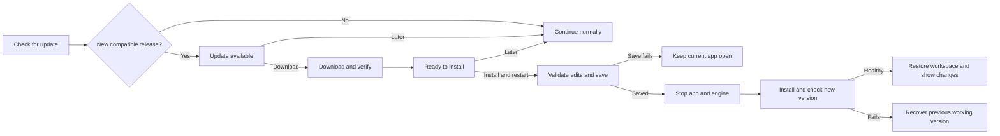

> Historical installer/update design, captured before the 0.3.0-beta.1 rename.
> This document preserves earlier implementation notes and future proposals.
> Product paths, release URLs and version examples below are historical or
> proposed, not current download instructions. Use
> [current installation and updates](INSTALLATION_AND_UPDATES.md) and
> [the beta tester guide](BETA_TESTER_GUIDE.md) for current behavior.
# Vine Mix installation and update architecture

Status: **first installer and manual upgrade/repair implemented 20 October 2026**.
The online updater, version switching, recovery journal and release highlights
below remain proposed future work. The repository stays private during
development; public GitHub releases will provide the eventual update source.

## Current installer

Run `scripts/build-installer.ps1` to build
`artifacts/installers/VineMix-0.2.0-Setup-x64.exe` using pinned Inno Setup 7.1.0.
It targets Windows 11 x64, requires acceptance of the installer terms and uses a
stable, per-user application directory at `%LOCALAPPDATA%\Programs\Vine Mix`.
The desktop and engine remain together in that folder. User settings, saved
workspaces, preferences, backups and logs retain their existing
`%LOCALAPPDATA%\AudioMixer` location. This first installer uses a flat stable
payload rather than the future versioned launcher design below.

The driver page detects the actual VB-CABLE and VAC hardware/installed-package
identities, including disabled, nonpresent and staged devices. It skips existing
packages, offers only confirmed missing drivers, shows vendor terms/usage limits
and requires separate acceptance before launching their original elevated setup
windows. Both complete official driver packages are available offline in the
free, non-commercial bundle. It never removes a driver during app uninstall.

Re-running Setup repairs application files or upgrades an older marked version;
a marked newer version cannot be downgraded. Setup will not force-close a mixer
or overwrite a target in use. A portable copy elsewhere can continue while files
are installed into an unused folder, but all copies share per-user settings,
mutexes and the control pipe. Setup suppresses a second launch while any copy is
running. Installing drivers requires the running mixer to be quit first.

Uninstall removes owned application files and shortcuts, retaining personal
data, unknown user files and shared drivers. It removes the start-at-login value
only when it points exactly to this installed copy. Start-at-login remains an
application preference; Setup does not change it.

The app, helper and generated installer are unsigned development artifacts.
Driver package signatures and original file hashes are verified during build;
that does not sign or certify Vine Mix. See the
[installer source and verification guide](../installer/README.md),
[distribution conditions](DISTRIBUTION.md) and installed SetupSupport help.

## Proposed automatic update architecture

Vine Mix will use one setup executable for first installation and upgrades. The
desktop checks for releases and offers the update; a separate helper coordinates
saving, shutdown, installation and recovery. Release highlights are installed with
the application and shown after a successful upgrade.

## Components and responsibilities

| Component | Responsibility |
|---|---|
| Release pipeline | Build a matched desktop/engine package, run verification, sign artifacts and publish the installer, signed update manifest and release notes. |
| Setup executable | Install the app, launcher, notices and shortcuts; detect optional driver prerequisites; coordinate vendor setup and any restart. |
| Stable launcher | Start the active complete application version and preserve one reliable target for shortcuts and start at login. |
| Desktop update service | Check, compare versions, display availability and download verified updates asynchronously. It does not perform work in the audio callback. |
| Update coordinator/helper | Require successful saving and both processes exiting, stage the replacement, switch versions and recover an interrupted installation. |
| Release highlights view | Explain changes after the updated app is healthy; remember dismissal and remain available from Help. |

Recommended starting point: **Inno Setup plus an in-app checker and a small update
helper**. Inno supports a single executable, conditional component setup and
ordered execution of other installers. The application-specific save handshake,
version switching and recovery journal must be implemented explicitly; they are
not implied by choosing an installer builder. Confirm the selected builder
version's licence and commercial-use terms before distributing it.
[Inno Setup features](https://jrsoftware.org/isinfo.php),
[conditional execution](https://jrsoftware.org/ishelp/topic_scriptcheck.htm),
[running other installers](https://jrsoftware.org/ishelp/topic_runsection.htm).

## Proposed versioned installation and saved state

Use a per-user application installation initially. Driver installation is a
separate elevated operation and must not change which Windows user's data is
being edited.

| Purpose | Proposed location |
|---|---|
| Launcher, updater and uninstall registration | `%LOCALAPPDATA%\Programs\Vine Mix\` |
| Complete version payload | `...\versions\0.3.0\` |
| Active/previous version pointer | `...\installation.json` |
| Existing saved workspace, UI preferences and logs | `%LOCALAPPDATA%\AudioMixer\` |
| Staged updates and recovery journal | `%LOCALAPPDATA%\AudioMixer\Updates\` |
| Pre-update state backups | `%LOCALAPPDATA%\AudioMixer\Backups\<version-and-time>\` |

The version number above is an example. Keep the existing `AudioMixer` data
directory for compatibility. Saved state is already independent of the program
folder: `settings.json`, its last-good backup, `ui.json` and the engine log live
there. A future data-directory rename requires an explicit, verified migration;
it is not needed to ship the installer.

Update shortcuts and `StartupRegistration.SetEnabled` to resolve the stable
launcher, respecting the user's current start-at-login choice. That method
currently writes `Environment.ProcessPath`; leaving it unchanged would replace
the launcher registration with a versioned executable at the next session. Installing
a new version must not create another startup entry or reset node assignments,
levels, mutes, workspace layout or preferences. Keep user data on uninstall by
default. Shared audio drivers remain installed.

## First installation

1. Check Windows and architecture compatibility, destination, disk space and
   existing Vine Mix processes/installations.
2. Detect driver packages and usable endpoint identities, including installed but
   disabled devices. Renamed or temporarily absent endpoints must not cause a
   duplicate driver installation.
3. Show optional virtual-audio components with their publisher, terms and current
   status. Install only missing, selected components through supported vendor
   setup. Keep the app usable without optional virtual routes.
4. Request elevation only for the driver operation, record its result, and handle
   any required restart. Recheck driver/device readiness after installation.
5. Install the matched app/engine payload, launcher, notices and shortcuts. The
   self-contained package already includes .NET and native runtime files.
6. Open a short first-run setup view, with a clear route to driver troubleshooting.

Driver packaging remains subject to [the distribution guide](DISTRIBUTION.md).
Base VB-CABLE allows bundled/silent installation under its published conditions;
VAC Lite's home/non-income restriction prevents treating it as an unrestricted
prerequisite. Keep driver integration behind separate component adapters so the
eventual licensing choice does not require redesigning application updates.
[VB-Audio terms](https://vb-audio.com/Services/licensing.htm),
[VAC licence](https://vac.muzychenko.net/en/license.txt).

Normal app upgrades skip compatible installed drivers. A driver change must be
an explicit prerequisite decision, with its own explanation and restart handling.

## Update source and release contract

While the repository is private, there is no anonymous production update channel.
Keep live checking disabled until a published channel is configured. Do not
embed a developer GitHub token or expose draft releases. Development tests can use
local fixtures and simulated downloads.

Once public, use GitHub Releases for installer assets and one signed manifest
envelope attached to the published release. The initial stable discovery URL is
`https://github.com/acoyeen/vine-mix/releases/latest/download/updates-stable.json`.
Its signed payload contains version-specific installer URLs, never another
mutable `latest` URL. Keeping payload and signature in one envelope prevents
separate requests from resolving to different releases during publication. Draft
and preview builds are excluded. An owned-domain URL can later front the feed without
changing the release model. The domains `vinemix.app` and `vinemix.dev` are planned,
not deployed by this architecture.

The manifest needs a format version, product ID, app version, channel,
architecture/OS compatibility, release date, installer URL, byte size, SHA-256,
state-schema compatibility and a bounded plain-text summary. Treat new versions
with a defined semantic-version comparison and reject unintended downgrades.

Sign the manifest bytes with a release-signing key whose public verification key
is pinned in the client. Require a valid trusted Authenticode signature from the
expected publisher on the downloaded installer, in addition to matching its size
and digest. Validate allowed origins and redirects. A digest obtained from the
same untrusted download location is not sufficient proof of publisher identity.
Define signing-key/certificate rotation before shipping automatic updates; keep
private signing material in the release environment. The envelope carries the
exact signed payload bytes and its signature so verification does not depend on
reformatting JSON.

Use one version source to generate desktop, engine, installer, manifest and
release-content versions. The current desktop project and CMake file specify
`0.2.0` independently; release tooling must prevent mismatched pairs.
[GitHub Releases](https://docs.github.com/en/repositories/releasing-projects-on-github/about-releases),
[release asset links](https://docs.github.com/en/repositories/releasing-projects-on-github/linking-to-releases).

## User update flow

Check after startup settles and at most daily while running, with a manual
**Check for updates** action and a user preference for automatic checks. Offline,
rate-limit and server failures must leave audio and editing available; manual
checks can report the failure with a retry action.

Use a non-modal availability message with the version, concise highlights,
**Download update** and **Later**. Display download progress/cancellation, then
offer **Install and restart** and **Later**. Explain that installation briefly
stops audio. Preserve focused numeric drafts before any notification button can
move focus, including Download and Later; validating in a later click handler is
too late for the current lost-focus behavior. Never start installation or close the running mixer solely because
an update was discovered.

### Required save and shutdown handshake

The install action must use a new `PrepareForUpdateAsync` operation:

1. Finish active gestures and explicitly validate/commit focused numeric editors
   before moving focus. Invalid drafts keep the current editor and cancel the
   update attempt; an update notification must not discard typed text.
2. Enter an explicit maintenance mode: freeze graph editing, pause polling and
   automatic engine supervision, and disable explicit restart. Coordinate with
   the existing engine gate, flush queued edits against the latest engine
   revision and confirm persistence. Supervision must not relaunch an engine
   that the helper just stopped.
3. Record a verified pre-update backup and current state schema. If saving fails,
   restore editing, polling and supervision and leave the current app usable.
4. Hand a narrowly scoped transaction to a trusted local helper through secured,
   current-user IPC. The helper cannot be instructed to run an arbitrary path or
   command. Verify process identity and installation path.
5. Shut down the matching engine cooperatively, then the desktop, and wait for
   both processes to exit before switching versions. Failure to exit cancels the
   update; window close/hide is not proof of process shutdown.

Do not reuse the current Quit path unchanged: it can stop after returning an
unsaved-change warning. Do not reuse the developer activation script as the
customer updater: disk quiet and force-closing a UI do not prove its pending
in-memory edits were saved. Installer mutex checks are an additional guard,
not a replacement for this handshake.
[Inno AppMutex](https://jrsoftware.org/ishelp/topic_setup_appmutex.htm).

Existing `0.2.0` clients have no update-preparation IPC. When an older portable
copy cannot negotiate the handshake, first installation must ask the user to
finish edits and quit it manually, then verify both processes have exited.
Preserve its files and existing user data; do not simulate acknowledgement by
force-closing it.

## Installation recovery

The helper is the **single transaction owner**. It obtains a secured current-user
installation/update lock before requesting preparation and holds it through
shutdown, staging, version switch and durable health acknowledgement. Setup,
uninstall and the launcher respect that lock; only the helper can authorize the
candidate health-check launch. An abandoned lock plus an unfinished journal
enters recovery rather than starting competing versions.

Inno owns its wizard, authorized file-copy phase and uninstall bookkeeping. The
helper owns the transaction journal, active-version pointer, recovery decisions
and reconciliation of installer registration after rollback. Give these steps a
documented success/cancel/failure/reboot result contract. Inno's normal copy-phase
rollback or appended uninstall log does not provide this complete transaction.
[Installation order](https://jrsoftware.org/ishelp/topic_installorder.htm),
[uninstall log behavior](https://jrsoftware.org/ishelp/topic_appendnotes.htm).

Run the transaction helper from a verified, transaction-specific staged copy so
the installed helper itself can be replaced. The stable launcher normally hands
off to the desktop and exits; setup verifies it has exited before replacing it.
Back up bootstrap files and registration as well as the application payload.
New bootstrap files must understand any unfinished prior journal. These files
must not be overwritten while they are executing.

Stage each complete version separately and keep the previous payload. Persist a
bounded transaction journal before each irreversible step; switch the active
version pointer atomically only after payload verification. Recover an
interrupted switch on the next launcher run.

The candidate starts in a guarded read-only phase, suppressing user edits,
automatic assignments and other state writes until the helper durably commits
the successful launch. Prepare and validate migrations in staged data, then
commit them through the same journal before enabling edits. Verify the expected
build/protocol, loaded workspace and an advancing processing timeline. An unplugged
device is not itself an update failure. This health check does not claim audible
or physical-device qualification.

Retain the old payload until the first successful launch is acknowledged. On a
failed first launch, revert binaries only if the saved-state schema and saved
features/node kinds are compatible with the previous app. A matching schema
number alone does not prove compatibility.
If migration occurred before the app became usable and no new user edits exist,
the verified pre-migration backup can restore the old state. Check state hashes
against the transaction to detect external changes before restoring. Otherwise offer
recovery explicitly; never overwrite newer user changes with an older backup.
Limit automatic recovery attempts to prevent restart loops.

## Feature and release screens

Ship curated release highlights with the application, rather than displaying
arbitrary remote HTML. Use feature cards with a title, a short explanation and,
where useful, a local illustration and a **Show me** action. Include important
behavior changes and a link/action for full release notes.

Show **What's new in Vine Mix <version>** once after a successful updated launch,
when the workspace is visible and no numeric editor or gesture is active. A tray
or background launch defers it until the user opens the workspace. It must be
dismissible without changing audio routes or requiring a tutorial.

Persist `lastSeenReleaseVersion` only when the screen is dismissed; keep it in
update-specific user state, separate from graph settings and Undo history. If
several releases were skipped, include relevant bundled highlights since the
last seen version. Keep **What's new** available from Help for reopening.
First-time setup uses its own welcome/driver guidance, not an upgrade notice.

## Implementation sequence and acceptance

1. Establish the version source, bundled release-content format and stable path
   policy; add the save/prepare handshake with detached regressions.
2. Build the first-install/upgrade package, optional driver adapters and cooperative
   process coordination. Test in disposable Windows environments.
3. Add the manifest reader, verification, background check and consent/download UI
   against local test fixtures; add journalled installation and recovery.
4. Add post-update highlights and the Help entry. Test first install, upgrades,
   skipped versions, dismissal, foreground/background startup and focus safety.
5. Enable the public release channel only after repository publication, signing,
   vendor redistribution decisions and full release qualification.

Required failure tests include pending-edit save failure, invalid numeric drafts,
stale engine revisions, supervision relaunch during shutdown, a concurrent
launcher/setup/update attempt, focused-editor clicks on every update action,
truncated/tampered assets,
wrong publisher/product/architecture, unsupported state schema, offline checks,
disk exhaustion, installer cancellation, required reboot, failed new-engine start
and interruption at each journalled step. Verify that recovery preserves the
last committed workspace and that ordinary updates do not reinstall drivers.
