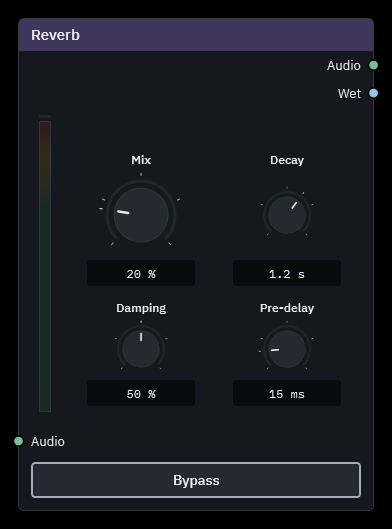
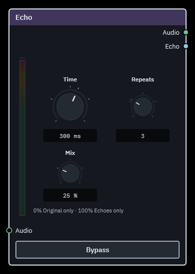

# VineMix user guide

A Windows 11 audio mixer built around draggable nodes and visible audio cables.
Create sources, processing chains and destinations on a resizable node canvas, with
settings inside each node. The C++ engine handles audio in a separate process;
the WPF desktop handles editing, telemetry and tray behavior.

This guide describes **0.5.0 Beta**. See the
[release notes](releases/0.5.0-beta.md) for changes and the
[qualification record](RELEASE_0.5.0_QUALIFICATION.md) for tested scope and limits.

For the current beta, installation, first-session setup, driver
terms, manual updates and reporting, start with the
[beta tester guide](BETA_TESTER_GUIDE.md). The version beside the connection dot
identifies the beta; **Settings → About VineMix** provides copyable full release
and build information.

A fresh workspace contains a ready-connected voice chain: **Microphone →
High-pass filter → Denoiser → Expander → Compressor**, followed by separate
cables to **Listening output** and **Virtual output**. The seven nodes have
consistent gaps to keep cables visible, with the two outputs stacked on the
right. The initial view fits the setup to the window.

Choose your physical microphone and headphones explicitly. Both outputs start
muted; Listening output starts at −24 dB. A recognized VAC virtual output can
bind automatically while remaining muted. The Denoiser starts with RNNoise,
which adds 30 ms of processing delay, including in bypass. Adjust the cleanup
and dynamics controls to your microphone and voice. Existing saved workspaces
retain their graph, controls, view and assignments; this starter applies to a
new workspace or an explicitly chosen **Start fresh** recovery action.

## Node library

- **Inputs:** physical microphone, base VB-CABLE virtual input, running application.
- **Mixing:** Mix, Balance, Mono, Channel Swap, Stereo Width, Pan, Crossfade,
  Stereo Combine and Stereo Split; a linked control adjusts several levels together.
- **Processing:** interactive EQ with up to eight bands, High-pass, Low-pass,
  Low / Mid / High tone controls, Voice Color, Compressor, Limiter, Ducking,
  Expander, Gate, Alignment Delay, Denoiser, De-esser, Plosive remover, Reverb,
  Echo and Distortion.
- **Outputs:** physical or streamed listening output and VAC Lite virtual microphone output.

The creation menu contains **32 node types**. Mix acts as a volume control with
one incoming connection and combines sound when several connections arrive.
Gain / Multiply and Reroute are no longer offered for creation; existing saved
nodes still work, bringing the compatible engine library to 34 types.

**Level control** inputs appear on nodes with dedicated **Level** knobs:
Physical input, Virtual input, Running app, Mix, Listening output and Virtual
output (plus saved Gain/Reroute nodes). Connect a **Linked control** to scale
those levels together. Its **Multiplier** starts at **100%** in the middle of
a **0–200%** dial: 0% silences, 100% leaves levels unchanged, and 200% doubles
signal amplitude (about +6 dB). This is amplitude, not perceived loudness.
Bypass removes the multiplier, including a zero setting.

Effects and other mixing utilities have no new Level control input. To control
their output level, route their audio into a Mix node. Existing control links
from older workspaces remain visible and functional until removed; they are
not silently moved or deleted. Existing decibel-based Linked controls keep
their exact gain until edited. Out-of-range legacy percentages are displayed
explicitly with a **Use multiplier** action to reset to 100%; they are never
silently clamped. Level knobs elsewhere retain decibels and their existing names.

To place two microphones in separate stereo channels, connect one to Stereo
Combine's **Left** input and the other to **Right**. Each socket averages its
incoming stereo channels to mono, then assigns that sound to its named side.
An unconnected side stays silent. Stereo Split does the reverse: its **Left**
and **Right** outputs each carry the extracted channel as centred mono, so each
can be processed separately and reconnected to Stereo Combine. Splitting a mono
source produces two identical mono outputs. Split and Combine have no bypass.

Channel Swap exchanges the sides. Stereo Width is unchanged at 100%, mono at
0%, and wider above 100%; it does not generate stereo from mono. Pan first
combines its input to mono and positions that signal; centre uses −3 dB on each
side for constant-power panning. Balance preserves the original stereo channels
and reduces the opposite side instead. Bypassing Pan restores the original stereo.

Crossfade blends separate stereo **A** and **B** inputs. It starts with A only;
turning toward B lowers A while raising B. **Equal power** suits unrelated
sources such as two music apps; **Linear** suits aligned copies of the same
signal, such as an original and processed branch. Equal power can raise the
level of correlated signals at the centre. Bypass selects A. Unequal effect
delays need manual Alignment Delay before blending; there is no automatic
parallel-path delay compensation. Missing inputs remain silent rather than
automatically selecting the other source.

The graph supports up to **32 nodes and 96 connections**. Sources can feed several
destinations, and each distinct output device has independent buffering and recovery.
This is routing capacity, not a guarantee for every effect combination. Large
collections of Distortion or RNNoise nodes need more processing time. When
several branches need the same cleanup, place one Denoiser before the split.
New outputs start muted; physical outputs require explicit selection. Existing A/B routes migrate with their
saved levels, mutes, devices and disabled sends.

Several input nodes can use the same microphone, virtual input or running app.
Right-click an input and choose **Duplicate input** to create a selected copy
nearby, keeping its source and controls but starting without connections. Rename
and connect each copy wherever it fits your graph. Level, mute and Mono remain
independent per node, and duplication supports Undo/Redo. Copy/paste also retains
input assignments. If you route several copies into one destination, their audio
adds together.

Several output nodes can also use the same listening device or virtual output.
Each keeps its own Level, mute and incoming connections; their audio is added
together before being sent to the device. Right-click **Duplicate output** to
place another copy nearby. It keeps the destination and controls, and starts
muted without connections. Pasted outputs also retain their devices and start
muted. Muting or deleting one output leaves the others working. Repeating the
same signal through several outputs increases its level; VineMix does not
automatically turn down the combined mix. Each node meters its own path, while
output clipping can also indicate overload in their combined device mix.

Unavailable inputs and outputs gently flash their existing device/app name red and have a
faint red outer glow, with a red warning triangle above the volume meter.
Hover the device/app name for the reason and recovery guidance.
Reduced animation keeps the text steadily highlighted. A connected but muted
input or output keeps its ordinary appearance; silence alone never marks a device missing.
The warning clears when capture or playback reconnects. Device and app selectors remain
available while the engine is connected.

Hover a node's volume meter to see its highest observed left/right sample peaks
and any detected overloads. The readings are purely informative; clicking does
not clear them or change audio. Red caps stay lit for two seconds after the last
detected overload, then fade back to gray over one second. Hover readings retain
their history. Changing the source, muting it or losing its audio connection
clears its history.

Use **Settings → Restart audio engine** to restart audio processing and reconnect
your existing routes. Audio briefly stops during the restart. The workspace
stays open, and queued edits are preserved if they cannot be saved beforehand.

Virtual nodes show their device name and connection status without a dropdown.
The virtual input automatically binds the **CABLE Output** recording endpoint;
the virtual output binds the **Line 1** playback endpoint. Apps send sound to
**CABLE Input**, and Discord/games receive the mix through the **Line 1** recording
device. Automatic assignment requires a single eligible, active endpoint. Multiple
virtual inputs can share it, and multiple output nodes can share a destination.
Saved selections stay assigned while absent.
For duplicate devices or a driver reinstall, right-click the virtual node and use
**Troubleshooting → Reassign device**.

Use **Add**, **Shift+A**, or **F3** to search. Drag a header or unused node space to move it; connect
matching sockets by dragging or clicking them. Middle-drag pans, the wheel zooms
over every node control (open dropdowns and menus keep their own scrolling)
through fixed stops from **10% to 200%**, and **Home** fits the graph. Select one or more nodes and
press **F**, or right-click a selected node and choose **Frame selection**, to
focus that part of the graph. Click the zoom percentage or
press **Ctrl+0** to return to 100%. Select a cable or node and press **Delete** to remove
it. Zooming out progressively simplifies node details while keeping their size,
position and cable anchors fixed. Zoom in to edit hidden controls and connections;
an active edit is kept visible. Audio sockets are round; shared-control
sockets are square; detector-only sidechain sockets are diamonds. Reverb's Wet
output and Echo's Echo output are light blue and retain the round audio shape. Ordinary
cables blend from their output socket colour to their input socket colour;
matching colours remain solid. Selection and muted styling still identify
those states. A small stationary dot marks each enabled cable's midpoint while
node details are visible, and hides with simplified nodes. Disabled cables have
no marker. Markers remain underneath
nodes, so their presence or absence in a gap can help trace where a cable goes.
Every scalar numeric parameter uses the shared dial control. Related effect controls form
compact groups, with persistent labels, values and units. Drag up/down, hold
Shift for fine adjustment, or click the number and type an exact value. When a
dial has keyboard focus, typing a digit, minus sign or your locale's decimal
separator also starts exact entry, retaining the first character. Selecting a
node alone does not start an edit. The saved value stays unchanged until commit. Enter,
Tab, Shift+Tab or clicking away applies a valid value. Invalid text stays visible
with a validation outline and is not applied; correct it or cancel the edit.
Right-click the value for **Apply value** or **Cancel edit**; Escape also cancels.
Each dial and its value box has its own Tab stop. Double-click or Home resets the focused dial; EQ frequency
resets to the selected band's reset anchor. Arrow keys adjust the focused dial,
and Page Up/Down make larger changes. Focus remains visible. Decimal precision
is retained, and sample and repeat counts accept whole numbers only. The wheel zooms the
canvas without changing parameters. Essential dial instructions remain visible
in the workspace footer. Selectors, action buttons, toggles and passive readouts have
separate shapes and positions; the EQ graph and Voice Color pad remain interactive.
Tooltips describe each control's purpose or current state. Mouse and keyboard
instructions are in **Settings → Help & shortcuts**. Open **Settings** at the top
right for workspace preferences, start-at-login, Windows sound settings and
device recovery.
Search stays at the top. Separators group workspace controls first, audio tools
second, app startup and updates third, then Help, What's new? and About. Quit
remains separate at the bottom. Activity sits directly after Find node.

The bottom-right **minimap** is shown by default and displays the graph and the part currently visible.
Click it to centre the canvas there, or drag to pan. Turn off
**Settings → Show minimap** to hide it; this saved interface preference does not
change audio or the graph. Panning and zooming do not immediately write audio settings.

With canvas keyboard focus, arrow keys nudge selected nodes; hold **Shift** for
finer movement. With nothing selected, arrows pan instead. Layout lock prevents
nudging selected nodes; it does not turn that action into panning. A held arrow
is one undoable move; use Undo to reverse it. Controls keep their own arrows.
**Ctrl++ / Ctrl+-** zoom around the centre of the canvas. The shared plus/equal
key works with or without Shift; numpad plus and minus work too. Focused editors
and controls retain their own keys.
**Ctrl+Tab** follows an audio pipeline forward and **Ctrl+Shift+Tab** goes back,
including muted routes. At a branch, choose a named node and port; at an endpoint,
navigation stays put. The destination is brought into view at a readable zoom.
Valid numeric drafts commit before travel; invalid drafts stay available for
correction or Escape. **Tab/Shift+Tab** retain ordinary control traversal.
**F2** renames exactly one selected node or group; multiple or empty selections
are ignored. Node renaming remains available under layout lock; group renaming
requires an unlocked layout.

Physical device dropdowns show available devices by default. Under
**Settings → Audio device visibility**, optionally show disabled, disconnected
or advanced endpoints. Current saved selections stay visible while unavailable;
the filters never clear assignments or change audio routes. See the
[device visibility guide](DEVICE_VISIBILITY.md) for categories and recovery.

**Settings → Help & shortcuts** (or **F1** outside text entry) opens six topics:
**Controls**, **Dials & values**, **Buttons & menus**, **Search & results**,
**Equalizer**, and **Meters & status**. Controls shows one group at a time.
Shaded section headers have expand arrows; indented rows show each action and
its keys. Select an action row for its explanation.
The remaining topics use real controls with temporary sample values. Examples
do not play or record audio or change your live mix or its Undo history.

Choose **Reset example** to restore a lesson's starting values. Changing topics,
or closing and reopening Help, starts a fresh example; practice values are not
saved. Help remembers which topic you were viewing for the current app session.

The wheel scrolls Help, including over example dials and closed selectors;
open dropdowns and menus keep their own scrolling. **Escape** first
cancels an unfinished practice edit, gesture or open choice, then closes Help
when there is nothing to cancel. **Close** returns directly to the workspace.
Your live workspace is unavailable for editing while Help is open, and audio
continues running. At narrower sizes, the topic list becomes a dropdown and
the content scrolls, including at the supported minimum window size of 900 × 580.

Use **Search settings and help** at the top of Settings to find options and
instructions. For example, **Zoom** shows mouse-wheel zoom and zoom-reset help.
Information appears directly in the menu. Use Up/Down to choose an instruction,
then Enter or double-click to open its entry in Controls. Tab moves to matching
settings; Shift+Tab returns to search. Searching does not run commands or change
settings.

**Settings → Find node…** (or **Ctrl+F** outside text entry) searches the current
workspace by node name, type, assigned device or app. Choose a result to select
and frame it. Escape closes search without changing the view or selection.
To tidy a selection of two or more nodes, right-click and choose
**Align selected nodes → Left edges** or **Top edges**. Each alignment is one
Undo step and keeps the nodes' connections and sound controls. Nodes form a
column or row with a fixed 48-DIP gap between their actual bodies, closing larger
gaps and opening smaller ones. Cable direction
determines connected-node order, so shuffled chains align from source to destination.
With the canvas focused, **Alt+X** makes a horizontal row and **Alt+Y** makes a
vertical column. **Alt+A** runs **Auto Align**, choosing the direction the
selection already extends furthest; ties use a row. The same actions are in
the alignment submenu.

When nodes overlap, the most recently selected or dragged node stays in front
after release. This visual order lasts for the current app session and does not
change the nodes' sound or connections.

To organize a section visually, drag over empty canvas to select its nodes, or
Shift-click to add and remove nodes from the selection. Right-click and choose
**Group selected nodes**, or press **Ctrl+G**. A group is a named background
frame with no inputs, outputs or audio behavior. Its heading shows only the
centered group name.

Click the heading or an exposed area of the group background to select it;
drag either to move all its members together. Nodes and cables keep their own
controls. Hold **Shift** or **Ctrl** while dragging the group background to
box-select nodes, or use middle-drag or **Space+drag** to pan. The frame automatically
fits the member nodes as they move or change size. Double-click the title, or
select only that frame and press **F2**, to
rename it. **Enter** applies the name, **Escape** cancels, and clicking elsewhere
applies it. Right-click the heading or exposed background for **Group color** and choose Sage, Teal, Blue,
Violet, Rose, Amber or Slate. **Ungroup (keep nodes)** removes the frame while
keeping every node and connection; Delete has that same effect when the frame
is selected.

Each node belongs to at most one group; groups do not nest. Use the selected
nodes' **Add to group** or **Remove from group** menu to change membership.
Dragging a member beyond the frame keeps it in the group and expands the frame.
Grouping and membership changes support Undo/Redo. Copying all of a group's
members preserves its name and color around the pasted copies; copying only
some members copies those nodes without the frame. Selecting the group
before **Ctrl+C** copies the whole group. **Fit**, **Home** and **Frame selection**
include the relevant group headings when bringing nodes into view.

For VR controllers or mice without an accessible middle button, enable
**Settings → Right-click drag to pan**. Drag with the right button
on empty canvas to pan; release without dragging to open the context menu.
A small movement threshold ignores pointer jitter, and holding still keeps the
gesture a click. Middle-drag continues to pan and **Ctrl+right-drag** continues
to cut cables. The option is off by default and is saved as a workspace UI
preference; it does not change audio settings.

The Add menu groups nodes into **Inputs, Outputs, Effects, Mixing and Controls**.
Effects contains the full effect library, including Low / Mid / High, Equalizer,
Reverb, Echo and Distortion, in one menu. Node headers retain their category
colours. Search also accepts a category
name. The upper toolbar holds creation, selection, Undo, Redo, Fit and zoom
controls, with the node count centred beneath the logo. Open **Settings → Activity**
for session history. Connection status stays in the header; save status is centred in
the footer. Action results and errors temporarily replace it. A thin green bar
shrinks from right to left over five seconds, then the save status returns.
**Dismiss** returns to save status immediately. The latest message remains in
**Activity**, and control instructions are available in **Help & shortcuts**.
Turn off **Settings → Show action notifications** for a quieter footer. This
saved preference hides routine timed messages immediately; errors and save
status remain visible, and Activity still retains recent edits and the latest
message. Notifications are on by default.
Drag the title, passive header text or unused toolbar space to move the window;
buttons keep their normal actions and the canvas keeps its own gestures.
**Undo / Redo** restore up to 100 graph edits in the current app session. One
pointer drag is one step, including dial, EQ and Voice Color adjustments. Use
**Ctrl+Z**, **Ctrl+Y** or **Ctrl+Shift+Z**, or the toolbar buttons. Text fields keep
their own text undo. A new graph edit after Undo clears Redo. Canvas navigation
and app preferences are not part of graph history. **Activity** lists applied
edits and the latest workspace message. History starts fresh when the app opens.

Panning, zooming, selection and hover do not save audio settings. Actual node,
cable and parameter edits save automatically; unchanged values are ignored.
The current view is included in the next real edit, so navigation by itself is
session-only. Nodes reserve status space and keep their world dimensions when
devices reconnect, selection changes or parameter values change.
Layout-only saves preserve the active audio processing state; moving or naming
nodes no longer rebuilds their effect histories.

New EQ nodes start flat with no bands. Double-click an empty part of the plot
to add a bell band. The hint and band information are centred between the
decibel scales.
Ctrl-click points to toggle selection, drag empty plot space to box-select
(hold Ctrl to add), or press Ctrl+A with the plot focused to select all bands.
Drag a selected point or use the arrow keys to move the selection together;
hold Shift for fine movement. Delete removes selected bands, Home resets their
positions, and Escape cancels a selection box. The Frequency, Band gain and
**Width / Q** dials below the plot edit the active band only. Right-click a
point for **Shape** (Bell, Low shelf, High shelf, Notch), enable,
**Reset position** and removal. Double-click a band to return its frequency to
its reset anchor and its gain to zero; its shape and Q remain intact.
Right-click empty plot space and choose **Reset EQ to flat** to clear all bands.
The node's **Reset node to defaults** action also returns it to an empty EQ.
The EQ node is 620 DIPs wide with a 300-DIP-high editor, a smooth calculated
response line and a separate measured post-EQ audio spectrum underneath.
Bell Q remains 1 by default; lower Q broadens a bell. Width presets are removed.
Zero bands also gives a flat response; exact values stay directly below the graph.
Dedicated **High-pass** and **Low-pass** nodes expose cutoff
and resonance. Existing band settings are preserved. The **Low / Mid / High** node
offers three simpler dials, each from −12 to +12 dB: a 200 Hz low shelf, a 1 kHz
bell and a 5 kHz high shelf. Continuous control edits are coalesced on a 100 ms
target cadence, so new pointer movement does not postpone changes indefinitely.

Effects, Balance and Mono have no generic Level row. Their effect-specific
controls remain: for example, EQ band gains, compressor makeup and reverb mix.
Use a Mix node for a separate branch volume. Older saved nonzero effect levels
remain effective and are shown through the node's **Saved level** context action,
where they can be reset explicitly. Right-click any node for **Reset node to
defaults**: this resets sound controls while keeping its name, position, cables
and device/app assignment. Resetting an output restores its safe muted default.

The denoiser reduces steady noise, the de-esser controls loud high-frequency
consonants, the plosive remover controls low-frequency bursts, and reverb adds a
stereo room tail. See [the effect research and limitations](EFFECTS_RESEARCH.md)
and [the measured EQ analyzer](EQ_SPECTRUM_ANALYZER.md). The Denoiser node's
**Algorithm** dropdown offers **SpeexDSP** (Reduction, 0–40 dB) and **RNNoise**
(Mix, 0–100%). New denoiser nodes start with RNNoise at 100% Mix. Saved and
pasted nodes keep their chosen algorithm; older nodes without an algorithm
setting keep SpeexDSP. Reset keeps the chosen algorithm. Both run locally; RNNoise's model
is embedded. Denoising adds **20 ms with SpeexDSP / 30 ms with RNNoise**,
including while bypassed so toggling stays aligned. Parallel paths are not
automatically delay-compensated; mixing untreated and denoised copies can colour
the sound. New nodes are not connected automatically.

**Voice Color** combines tonal balance with broadcast character in one pad.
Move left for Warm, right for Bright, and upward from Natural toward Broadcast
to add body, presence, a low-mid cut, compression, density and subtle delayed
doubling with a small room. Larger labels sit inside the pad around a square
grid, clear of the handle. Bottom centre is transparent, with a discreet reset
marker and no Neutral text. Double-click resets both axes;
keyboard and exact Tone/Character dials provide precise adjustment. Existing
coordinates are retained and intentionally use the new sound treatment. This
original mapping does not reproduce Intellipan's exact sound or alter pitch.
See [Voice Color controls and mapping](VOICE_COLOR.md).

**Expander** and **Gate** are separate Add/search entries for reducing quiet
audio between phrases, with no mode dropdown. Expander has five dials:
Threshold, Ratio, Range, Attack and Release. Gate has six: Threshold, Hysteresis,
Range, Attack, Hold and Release. An older saved Expander in gate mode still
shows Gate controls and retains its saved settings without conversion.
Both have an optional **Trigger** input. With no cable, the node detects its own
Audio input. Connect another source to Trigger to control when the main audio
opens, without mixing the trigger into that audio. A connected silent, muted or
unavailable trigger stays silent; removing its cable restores self-detection.
For example, route music through Gate and a microphone into Trigger to let the
microphone open the music path. Route the microphone separately if it should
also be heard.

**Compressor** reduces its own louder audio using Threshold, Ratio, Attack,
Release and Make-up gain. It has no detector selector or sidechain input.
Older compressors may keep their Compress/Limit selector; their saved detector
field no longer changes processing. **Limiter** exposes Ceiling and Release
and enforces a sample-peak ceiling with no lookahead. Bypass removes limiting,
and later gain can exceed this node's ceiling.

**Ducking** lowers main audio in response to a separate trigger: Music → Ducking
→ Output, with Microphone → Trigger. Choose **Static ducking** for a set Duck
amount after the trigger crosses Threshold, or **Dynamic ducking** for reduction
that grows with the trigger's level according to Ratio. Both show Threshold,
Attack and Release, with either Duck amount or Ratio. Static is the default,
with Threshold −30 dBFS and Duck amount 18 dB; Dynamic's Ratio starts at 4:1.
Switching modes keeps both values, the current gain envelope, node size and
connections. Trigger audio never joins the audible mix, and the main audio
never substitutes for a missing trigger. Missing or silent triggers release
toward unity. Gate and Expander also accept Trigger, with the self-detection
fallback described above; Compressor and Limiter do not.

**Reverb** has two outputs. **Audio** keeps the blend selected by **Mix**;
**Wet** carries only the reverberation, independently of Mix. Decay, Damping and
Pre-delay affect both outputs' reverb. Wet preserves the effect's stereo
reflections, including when fed a mono source. Route dry sound directly to a Mix
node and Wet through another effect into that Mix to process the reverb separately.
Bypass returns dry sound on Audio and fades Wet to silence without dry leakage.
The reverb continues processing incoming audio and advancing its tail during
bypass; resuming fades in the current result, without
freezing or restarting the tail.



**Echo** has three controls:



- **Time** sets the gap between repeats, from 20 to 2000 ms; the default is
  300 ms. Very short times thicken or colour the voice rather than sounding
  like separate words. Start around 300 ms for clearly spaced repeats.
- **Repeats** sets exactly 1–8 copies after the original; the default is 3.
  Each copy becomes quieter. Repeats can overlap during continuous speech.
- **Mix** blends the original voice and echoes on the Audio output. At 0%,
  Audio is original voice only; at 100%, it is echoes only, so nothing is heard
  until the selected Time has elapsed. Mix does not change the repeat count.

Changing Time or Repeats briefly fades the old echoes and starts fresh, instead
of replaying the previous tail at a new spacing. Mix changes keep the tail.
The repeat levels are normalized to prevent buildup inside Echo, and left/right
channels stay separate.

**Audio** carries the Mix blend. The separate **Echo** output carries only the
repeats and ignores Mix. To put Reverb only on the echoed aftermath, set Echo's
Mix to 0%, route **Audio → Mix node**, route **Echo → Reverb → the same Mix node**,
then send that Mix to your output. Your original voice stays on the first path;
Reverb receives only repeats. Its own Mix controls how much reverb accompanies
those repeats. Sending Echo's blended Audio and its Echo branch to the same
destination can otherwise double up the repeats.

Bypass returns the original voice on Audio and fades the Echo output to silence,
without dry voice leaking into it. Processing keeps advancing during bypass.
Earlier development workspaces convert Feedback to an approximate repeat count
while keeping Time and Mix; old 35% Feedback becomes 5 repeats. This intentionally
replaces the previous indefinite feedback decay.

**Distortion** ranges from gentle warmth to strong saturation. **Drive** pushes
the sound into distortion (0–36 dB); **Tone** sets its brightness (500–18000 Hz);
**Mix** blends clean and distorted sound; **Output** trims the resulting level
(−24–0 dB). Output applies to the blend, including Mix at zero. Bypass passes the
original sound without that trim. Processing adds 32 frames at 48 kHz (about
0.67 ms), also retained at zero Mix and during Bypass to keep its internal paths
aligned. Parallel routes do not automatically compensate for this delay.
Drive can increase loudness as well as distortion; use Output to balance the
result. Bypass may therefore sound louder than a blend with a low Output setting.

**Alignment Delay** offers linked millisecond/sample editing from zero to two
seconds at 48 kHz. Settings, bypass, reset and copying follow the existing node
conventions. See [dynamics and alignment](CORE_DYNAMICS.md) for exact controls,
Static's detector smoothing/hysteresis, Dynamic's peak curve, trigger wiring,
timing and the limitations of sample-peak limiting.

The Shure MV7+'s **Real-time Denoiser runs inside the microphone**. Configure it
in MOTIV Mix and select the physical MV7+ USB input here to receive its processed
audio. The mixer cannot read or toggle that hardware setting, and its own
SpeexDSP / RNNoise Denoiser node is separate. No Shure software algorithm is bundled.
See [Shure denoiser setup and research](SHURE_DENOISER.md) for the supported
USB path, persistence evidence, and the later listening comparison.

The interface uses Blender-inspired coloured category headers, grouped dials,
typed sockets and a black canvas with near-black surfaces. Text uses scalable
font metrics and grayscale rendering to avoid coloured fringes at fractional
zoom. Node geometry stays fixed while progressively simpler detail makes a
zoomed-out graph easier to navigate. The 0.5.0 presentation,
**Quiet Blocks**, keeps plain solid charcoal bodies and category-coloured header
strips.
Simplified interiors contain no decorative type symbols, name/control text,
miniature controls or audio meters. Selection and device-warning indicators remain.
Node bounds, header height, sockets and cables stay fixed. Use Find to locate a
node; zooming in restores the full controls, labels and meters. The transition
near 30% avoids flickering around its boundary and defers simplification during
active edits; audio processing and retained peaks continue. High contrast uses
the existing system colours.
Group headings disappear;
groups keep fixed world-space bounds instead of expanding as zoom decreases.
Hidden controls cannot take focus;
keyboard navigation reveals a node before entering its controls.
Ctrl+0 returns to 100%. Meters reveal a fixed green-to-yellow-to-red gradient as
audio rises; the colour at a given level never changes with the fill height.
The unfilled scale stays subdued. Meters retain their full border, original peak
indicator and idle cap, with unchanged peak hold/release and a distinct warning
for actual clipping. High contrast uses
system colours. Inputs and outputs have
**Mute**; most intermediate nodes have a bottom **Bypass** button, grey when
off and red when on. Stereo Split and Stereo Combine have no bypass. Bypass
removes the audible effect while retaining settings and connections; some
effects keep processing or preserve their delay so transitions stay aligned.
Settings no longer include duplicate incoming-send controls.
The window resizes from
900 × 580 and includes maximise/restore beside its other caption controls.
New workspaces fit the starter chain to the window. Existing saved positions and zoom are retained,
without automatic rearrangement. See
[the visual implementation notes](BLENDER_NODE_STYLE.md).

Compatible sockets snap within a forgiving screen-space radius. The existing
port outline brightens without an extra hover circle. Compatible audio ports are
circles centred on the node border, even when their colours differ. Empty ports have coloured outlines and
connected ports are filled. Passive node surfaces use the
ordinary arrow cursor; the move cursor appears only during a drag. Drop an
unconnected effect or mix onto a highlighted cable to insert it into the path.
To unplug a cable, drag it from its **input socket** onto empty canvas. Drop it
on another compatible input to move that connection instead. Hold **Ctrl** and
right-drag across cables to cut them. These gestures preview changes until
release; **Escape** leaves the original connections intact.
**Alt-drag**, or right-click **Detach node (reconnect)**, lifts a node out while reconnecting its
single incoming path to its destinations. Ambiguous or unrepresentable rewires
leave the graph unchanged. Hovering previews the target; releasing commits;
**Escape** cancels. Existing saved cable gains and mutes remain intact.
Reverb and Echo still insert and detach through their main Audio paths. Detach
is refused while Reverb's Wet or Echo's Echo output is connected, so the operation
cannot replace an effect-only branch with dry sound; remove that branch first.

Read the [workspace guide](NODE_WORKSPACE.md) for node behavior, architecture,
migration and the Blender/TouchDesigner references behind this direction.

## Running apps as nodes

Windows process-loopback capture makes a Spotify or browser node possible without
adding a virtual cable for each application. It **copies the app's audio**; original
playback continues. To make the mixer the only playback path, assign the app to
VB-CABLE in Windows Volume Mixer and receive it through a Virtual input node.
Do not feed both copies into the same destination.

The virtual microphone sends directly to VAC Lite using exclusive WASAPI, keeping
its audio out of Windows' shared playback mix used for system-audio capture.
The listening and virtual outputs retain independent mutes. Direct access must be
allowed for Line 1; an unavailable direct connection reports an error instead of
falling back to shared playback. See [microphone audio in Discord screen shares](APP_AUDIO.md#microphone-audio-in-discord-screen-shares)
for the fix, measured results, and capture scope.

App trees, protected content and simultaneous sessions have limitations. See
[app capture and its Microsoft sources](APP_AUDIO.md). Real Spotify/game
capture and audible routing still require the deferred qualification session.

## Run and build

Use the top-right padlock to protect the workspace layout. A red closed padlock
means locked; a small grey open padlock means unlocked. The shackle opens and
closes when toggled. An attempted locked node or cable edit briefly enlarges the
padlock quickly, then returns it to normal size more gradually while keeping it red. Node selection
outlines stay hidden while locked and return for the current selection on unlock.
Selecting a node or cable stays quiet; missing-device warnings remain visible.
Windows reduced-motion settings use immediate, temporary emphasis. High contrast uses system
colors with the same distinct shapes and accessible state text. The lock blocks
moving, adding, deleting, pasting and aligning nodes, structural cable edits and
structural Undo/Redo. It also blocks group creation, movement, membership changes,
ungrouping, and group name/color edits. Volume, mute, bypass, device choices, node renaming, cable level,
parameter Undo/Redo, selection, copy, search, pan and zoom remain available.
Hiding and reopening the window preserves the lock; a new app session starts
unlocked. The lock does not change the saved graph.

The denoiser dropdown shows **SpeexDSP · 20 ms** and **RNNoise · 30 ms**. These
are VineMix's node delays, including bypass. They do not describe complete system
latency or CPU cost; perceived cleanup quality depends on the voice and noise.

**Settings → What's new?**, immediately below **Help & shortcuts**, opens curated
bundled highlights. After an update the notice waits for a healthy, visible, active workspace without an
editor, gesture, pending save or another dialog. A fresh install establishes a
baseline without an upgrade notice; an existing workspace from a version without
this feature gets one transition notice. Skipped versions include their available
bundled highlights. Dismissal is stored under `updates/whats-new.json`, separately
from workspace settings and Undo. Closing the notice leaves audio unchanged.
What's New, Updates and About use the same minimal window style. They open
centred and cannot be dragged or resized. Click back on
the app, press Escape or choose Close to dismiss them; an update installation
already in progress stays protected. **About VineMix** follows **What's new?**
in the help section, above the separately grouped **Quit VineMix**.

After building, open **`artifacts/VineMix-0.5.0-beta-Installed/VineMix.exe`** through
File Explorer. The native engine
is alongside it, and the package includes the .NET desktop runtime. Closing the
window hides it to the tray; choose **Quit VineMix** at the bottom of Settings or
from the tray menu to stop audio. Both actions save first. If the final save fails,
VineMix stays open while you retry, save a recovery copy, cancel quitting or
explicitly quit without saving. A recovery copy contains the audio workspace and
queued engine edits; it never overwrites an existing file. Group presentation and
other interface preferences must save successfully before this recovery option
allows quitting, because they live in a separate file. To inspect it separately,
quit VineMix and open the app with `--settings "<recovery-copy.json>"`, retaining
the original settings. Start at
login is optional and off by default.

```powershell
.\scripts\build.ps1 -NoBootstrap
```

While the personal mixer is running, build a separate candidate:

```powershell
.\scripts\build.ps1 -NoBootstrap -PackageDirectory "$PWD\artifacts\VineMix-Candidate"
```

The build refuses to overwrite a running controller or engine. Packages include
the current guides and licences; historical screenshots and test fixtures stay local.

Omit `-NoBootstrap` on a fresh checkout. Free project-local tooling consists of
.NET 10, LLVM-MinGW and CMake. Pinned libsamplerate, nlohmann/json, SpeexDSP and
RNNoise sources and the matching RNNoise model are fetched during native
configuration. The build script compiles and packages; it
does not run audio tests, install drivers or change Windows defaults.

Developers can use **`--preview`** in the separate verification build for a silent
interactive example. It opens no audio devices, starts no engine and saves no
settings. Preview and render modes are excluded from the release executable.

## Driver setup

The application reuses separately installed **base VB-CABLE** for incoming app
audio and **Virtual Audio Cable Lite** for its virtual microphone output. Neither
requires VoiceMeeter. Setup can offer missing drivers through the original vendor
installers; standalone users install them separately for virtual input or output.

| Node / application | Windows endpoint |
|---|---|
| Apps assigned to virtual input | VB-CABLE playback, usually CABLE Input |
| Virtual input node | VB-CABLE recording, usually CABLE Output |
| Virtual output node | VAC Lite playback, usually Line 1 |
| Discord / game microphone | VAC Lite recording, usually Line 1 |

Keep both sides of each cable enabled and Windows “Listen to this device” off.
Adding nodes does not create additional Windows endpoints. Incoming conversation
audio should stay outside any route returned to the virtual microphone.

Obtain drivers from [VB-Audio](https://vb-audio.com/Cable/) and
[VAC's official downloads](https://vac.muzychenko.net/en/download.htm). VAC Lite's
[private-home-use licence](https://vac.muzychenko.net/en/license.txt) permits only
private home use without income generation. The integrated Setup flow preserves
the original driver packages and separate terms; the standalone EXE contains no
driver installers. See [distribution conditions](DISTRIBUTION.md).

## Persistence and implementation

Configuration is stored at `%LOCALAPPDATA%\VineMix\settings.json`. Version 2
contains a graph; version 1 is migrated in memory. Reading old settings does not
rewrite them. The first edit saves the graph with an original-version backup and
an ordinary last-good backup. No microphone or listening device is substituted
because its name resembles a missing selection.

Beta 1 copies legacy AudioMixer data into this directory while retaining the
source files. An interrupted copy resumes from its journal; conflicting old
copies require a source choice. Damaged or missing established workspaces show
visible recovery before ordinary editing and audio. Retry, Restore backup and
Start fresh preserve originals. See [recovery](BETA_TESTER_GUIDE.md#recovery).

The dynamics redesign retains version 2 and the existing backup conventions.
Missing `dynamicsUiVersion` means legacy compressor presentation (`0`); newly
created compressors use `1`. Loading does not migrate a compressor, alter its
sound or rewrite its settings. Copy/paste retains the marker and saved controls.

The engine processes 48 kHz float32 stereo, in 240-frame blocks. Graph validation
and compilation occur outside the audio loop. Device and application workers own
bounded queues; an unavailable endpoint silences only its path. The local
current-user named pipe carries settings and telemetry, never microphone content.
Logs contain operational metadata. See [the protocol](CONTROL_PROTOCOL.md).

## Verification and current limits

[TESTING.md](../TESTING.md) separates offline graph/DSP and inert desktop checks from
later audible, hardware, latency and soak qualification. Building or opening the
window does not establish those hardware acceptance criteria.
Current implementation evidence is recorded in [NODE_VERIFICATION.md](NODE_VERIFICATION.md).

Run `scripts/verify-offline.ps1` for the complete silent maintenance suite: synthetic
audio, isolated settings, simulated endpoint inventory, private test pipes and
detached WPF rendering. It does not use the personal engine or audio devices.
The [maintenance review](MAINTENANCE_REVIEW.md) records fixes, measurements
and the limits of those checks.

The effect-quality audit corrected weak de-essing/plosive attenuation and
excessive reverb wet gain, and added measured reduction feedback. See
[de-esser measurements](EFFECTS_QUALITY_AUDIT.md) and
[the other-effect review](EFFECTS_QUALITY_AUDIT.md). Run
`scripts/verify-effect-quality.ps1` for the dedicated silent quality regressions.

The earlier uniform-zoom controller passed 583 detached checks (local historical report)
and 50 renders with zero binding errors. They verify that controls, node
proportions and socket geometry stay unchanged from 30% through 200%, including
manual collapse, repeatable Fit and the resizable layouts. Visual review of
50%/75% effects and Fit in the smallest window found no scoped issue.

The EQ/tone native update passed 48,522 graph assertions, 7,901 qualification
assertions and the synthetic engine lifecycle suite. The earlier readable-UI
candidate passed 226 offscreen checks (local historical report)
with 20 actual WPF renders at 96/144/192 DPI, zero binding errors and a Release
build with no warnings or errors. Visual review found no remaining issue within
that scope. [design-qa.md](../design-qa.md) records the review and tracks package
activation separately. Audible/physical interaction qualification and the
stopped endurance run remain **Deferred**.

This version has no VST hosting, recording UI, MIDI, network audio, ASIO routing or automated echo cancellation. Virtual microphone output uses exclusive WASAPI; parallel paths have no automatic delay compensation.
The Limiter and legacy compressor Limit mode do not provide true-peak detection
or lookahead. Final output saturation
protects sample bounds but is not a substitute for sensible mixing headroom.

The earlier fixed-console screenshots and test records remain under
`docs/design/` locally as historical evidence; the node workspace supersedes that UI.
