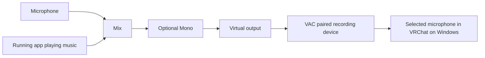
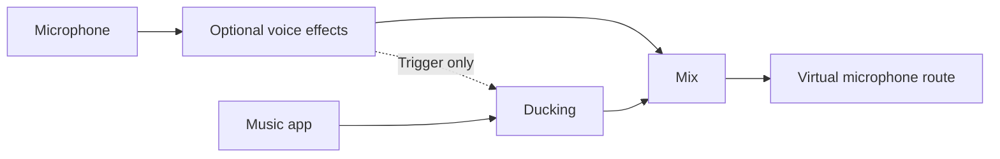

# VineMix website design dossier

> Historical website research and design decisions, recorded 20–21 October 2026.
> Dated implementation notes describe those stages. See the
> [website documentation](../website/README.md) for the current site.

Prepared **20 October 2026**, UTC+10. Internal research and design handoff for an informative product website. Status: research complete for an initial design brief; visual direction, release CTA and launch readiness remain decisions.

**21 October refinement:** The maintainer requested a standalone VM symbol centered on the landing, a GitHub button with the GitHub mark and a prepared documentation button. The visible opening sentence, header wordmark/navigation, scroll prompt and motion control are removed. The logo's lettering is custom vector artwork; the website retains the approved IBM Plex Sans, with SemiBold buttons. The GitHub button points to the existing project remote at the maintainer's explicit request, without changing its private visibility; Documentation is a disabled “Soon” placeholder. The shader settles after a five-second introduction. The maintainer subsequently requested the lagging preview be stopped during development, so the server and both preview tabs are closed; this refinement has static checks but awaits a new browser review. This paragraph supersedes the opening composition described in the 20 October note below.

**Subsequent local review direction, 20 October 2026:** The maintainer separately authorized a skeletal local website, then requested a memorable, almost purely visual first landing with about one sentence of descriptive copy and allowed resources such as 21st.dev. After rejecting the icon-and-beam version as tacky and generic, the maintainer selected Allan Mesquita Brito's exact [frorest-green shader](https://21st.dev/@allanmesquitab/components/frorest-green), recipe `4314dd3b-67c5-4cfd-b2d2-cc1184dddc47`. The current local implementation in `website/dist/` opens with that shader's cream, lime and forest field, the supplied wordmark, quiet navigation and “Mix your mic, music and apps.” Scrolling reveals the actual desktop workspace, a restrained VRChat music-sharing story and compact project information; phone, short-window and reduced-motion layouts use ordinary document flow. The upstream frontend-design and web-design-guidelines skills were reread and applied alongside Product Design selected-reference guidance; the plan and exact shader source/MIT provenance are recorded in `website/DESIGN_NOTES.md` and `website/SHADER_PROVENANCE.md`. This direction supersedes the earlier Animated Beam treatment and initial text-led hero recommendation for the loopback-only review page. Product evidence, experimental status, private-source/release constraints and all claim boundaries below remain applicable; earlier research-only scope statements describe the original dossier work.

VineMix should be introduced through a sound route that people can understand: bring in a microphone and an app, adjust their sound, and choose what reaches headphones or an outgoing virtual microphone. Its visible cables are both the product's defining visual feature and the clearest way to explain its usefulness. The website should feel like an approachable extension of the application: quiet dark surfaces, forest green, IBM Plex typography and purposeful connections, with larger text and more space than the desktop interface.

The primary audience is **everyday Windows users and gamers**, explicitly confirmed by the maintainer. **People playing music through their microphone in VRChat** are an explicitly requested audience and a prominent use case. A small, affectionate dig at the self-appointed VRChat DJ belongs in that story. The wider page should remain welcoming and understandable to someone who has never used an audio routing tool.

Two facts constrain the launch story. Version **0.2.0 is experimental**, with extensive automated verification but incomplete real-world audio and endurance qualification. The original code is **MIT licensed**, but the GitHub repository was **private with no published release** when checked. The eventual public website can confidently explain local processing, tangible safeguards and source openness once the source is actually public. It should not presently direct anonymous visitors to inaccessible source or downloads.

## Contents

1. [Brief and scope](#brief-and-scope)
2. [Product facts and mental model](#product-facts-and-mental-model)
3. [Audience and use cases](#audience-and-use-cases)
4. [Music through the microphone and VRChat](#music-through-the-microphone-and-vrchat)
5. [Capability and benefit inventory](#capability-and-benefit-inventory)
6. [Reliability and trust](#reliability-and-trust)
7. [Open source and release readiness](#open-source-and-release-readiness)
8. [Positioning and comparative context](#positioning-and-comparative-context)
9. [Visual direction](#visual-direction)
10. [Assets and capture plan](#assets-and-capture-plan)
11. [Page narrative and information architecture](#page-narrative-and-information-architecture)
12. [Interaction and responsive behavior](#interaction-and-responsive-behavior)
13. [Draft website copy](#draft-website-copy)
14. [FAQ content](#faq-content)
15. [Claims register](#claims-register)
16. [Features excluded from launch messaging](#features-excluded-from-launch-messaging)
17. [Frontend design skills research](#frontend-design-skills-research)
18. [Development and verification brief](#development-and-verification-brief)
19. [Decisions and next steps](#decisions-and-next-steps)
20. [Source map and research record](#source-map-and-research-record)

## Brief and scope

The website's job is to explain what VineMix does, help visitors recognize a useful application in their own setup, demonstrate that it is approachable yet capable, and give them an honest next step. It should be eye catching because the product is shown clearly and the examples are recognizable.

This dossier covers product understanding, audience hypotheses, supported workflows, trust evidence, editorial direction, asset suitability, page structure, frontend skill selection and acceptance criteria. It is an internal reference, so technical limitations and evidence are more detailed here than they should be on the eventual page.

The maintainer authorized research and documentation. This work does not implement a website, activate another build, alter audio routes, install drivers or adopt a new dependency. Website interactions and copy below are proposals. Proposed application features remain governed by the existing [ideas log](IDEAS.md); this dossier does not turn them into website promises or implementation decisions.

The question of the primary visitor action was left open. The working recommendation is to design for a **future public experimental release**, with a download CTA enabled only after an accessible release exists. A pre-release version of the page should instead lead to an on-page explanation of the workspace. This is a recommendation, not the maintainer's selected launch strategy.

## Product facts and mental model

### What VineMix is today

VineMix is a Windows 11 x64 desktop audio mixer with a node canvas. Users connect physical microphones, virtual-cable inputs and running applications to processing, mixing and output nodes. The audio graph is real: a source can branch to several destinations, and several sources can join one mix. Listening outputs and a virtual microphone output can have independent levels and mutes. [Product overview](../README.md), [user guide](USER_GUIDE.md), [node catalog](../desktop/VineMix.Desktop/NodeCatalog.cs).

Audio processing runs locally in a C++ engine. The desktop editor is a separate .NET/WPF process. Processing is 48 kHz stereo with 240-frame graph blocks. These facts belong in an optional technical detail area; a first-time visitor needs to understand what reaches whom before learning how the engine is built. [Architecture and graph behavior](NODE_WORKSPACE.md), [control protocol](CONTROL_PROTOCOL.md).

### Four concepts to teach

| Concept | Beginner explanation | Website treatment |
| --- | --- | --- |
| Node | One source, sound adjustment, mixer or destination. | Introduce three or four clearly named examples. |
| Cable | The visible route a sound follows. | Follow one green connection through a useful setup. |
| Branch | Send one source to more than one place, with different treatment if wanted. | Compare listening and outgoing microphone paths. |
| Virtual microphone | A software recording device another app can use as its microphone. | Show the receiving app outside the VineMix graph and explain the separate driver setup. |

Use **visible audio cables** in explanatory copy. “Nodes and noodles” can add personality once the basic meaning is clear. “Graph,” “DSP,” “sidechain” and “loopback” should not be prerequisites for understanding the hero.

### The most important routing distinction

A Running app node **copies the selected application's existing playback**. It does not automatically move that playback, mute the original application, change its Windows output or make VineMix its only listening route. Sending the copy to the same headphones as the original can produce doubled audio. Browser processes may contain several tabs; protected playback may be unavailable. [Application capture and routing](APP_AUDIO.md), [user guide application section](USER_GUIDE.md).

This makes music-to-microphone a particularly good first example: the music player can keep its normal headphone playback while VineMix sends its captured copy to the outgoing virtual microphone. A promise such as “EQ your game in one click” would hide the additional routing needed to hear only the processed copy.

## Audience and use cases

The priority and requested VRChat inclusion come from the maintainer. The needs, anxieties and likely visitor questions below are design hypotheses inferred from product behavior, not findings from interviews or audience analytics.

| Audience | Need and desired outcome | Best product proof | Message priority |
| --- | --- | --- | --- |
| Everyday Windows user | Understand where sound goes and adjust it without deciphering a fixed console. | A small source → adjustment → destination graph. | Primary; establishes approachability. |
| Gamer using voice chat | Shape the microphone and control what is heard locally versus sent to other people. | Separate listening and virtual-mic branches with independent mutes. | Primary; avoid claims of competitive advantage. |
| VRChat music player | Combine voice and music into the chosen microphone input, with useful control over both. | Music + mic → Mix → virtual microphone, followed by optional ducking. | Prominent named story with one playful line. |
| Curious audio tinkerer | Explore more control without immediately facing a large production tool. | EQ, Ducking, Voice Color, branching, search and Undo. | Supporting depth after the first example. |
| Open-source contributor | Inspect, build, modify or help improve the project. | Public source, MIT license, contribution and testing documents. | Clear secondary path after publication. |

Streamers and professional audio users may find it useful, but they are not the selected primary audience. Monetized creators also need to check the separately licensed virtual audio drivers. Do not make unrestricted commercial streaming the default promise.

### Priority stories

1. **See where your sound goes.** A microphone, a useful adjustment and an output explain the workspace in seconds.
2. **Bring music into your microphone mix.** A concrete, memorable use case with an explicit VRChat nod.
3. **Let music step back when you speak.** Introduce Ducking only after the basic mix is understood.
4. **Choose what you hear and what others hear.** Explain independent branches and mutes with a precise example.
5. **Shape the voice you send.** Show adjustable noise reduction, EQ and Voice Color without promising a universal improvement.
6. **Keep exploring without losing your place.** Search, Undo, saved workspaces and silent practice Help lower the perceived learning burden.

### Questions visitors need answered

The narrative should answer, in order: What is this? What could I use it for? Does the node interface make sense? What do I need to install? How mature is it? Is the source available? Where do I start?

Avoid making visitors infer whether a screenshot is a real app, whether the website itself processes audio, whether a virtual driver is bundled, or whether this runs on their standalone headset.

## Music through the microphone and VRChat

### Intended story and tone

The requested “dig” is best treated as a friendly recognition of the VRChat mic DJ. A suitable line is **“VRChat's unofficial DJ? At least get the mix right.”** Keep that joke inside the use-case section, paired with a useful explanation. The hero should introduce VineMix broadly enough to welcome other gamers and everyday users.

The user benefit is separate control of the voice and music being sent, plus the option to reduce music while speaking. The story does not require a soundboard, direct music-service integration, a VR overlay or a VRChat plugin.

### Simplest intended route



The receiving application and the paired driver endpoint are outside VineMix's editable node graph. A website illustration must make that boundary visible. The Mono stage is optional, rather than a mandatory hidden feature of Mix.

The microphone and music source have separate Level and Mute controls. Mix adjusts the combined stream. Muting Virtual output stops everything sent through that virtual microphone. Muting a listening output affects only that listening branch; it does not mute outgoing voice.

### Adding automatic music reduction



In the eventual visual, use green for audible routes and lavender for the detector-only Trigger connection. Mic audio must also connect to Mix through a green route: the lavender cable only tells Ducking when to reduce music and does not make the voice audible. Static ducking reduces music by a set amount; Dynamic ducking responds more strongly to a louder trigger. [Ducking behavior](CORE_DYNAMICS.md), `native/src/graph.cpp` around lines 284–299.

### Requirements and compatibility wording

- Select a **running player application** as the source. VineMix currently has no audio-file input, file drop player or built-in soundboard.
- This outgoing path uses separately installed **Virtual Audio Cable**, currently documented around its Line 1 endpoints. VB-CABLE is not necessary merely to capture an app and send it to this virtual mic; it is a different dependency used for the documented virtual-input route.
- In the receiving application, choose the driver's paired **recording** endpoint as the microphone. The VineMix output sends to its **playback** partner. Similar names make this a useful setup illustration.
- Target **Windows desktop and PCVR**. Do not suggest native support for standalone Quest, mobile VRChat, macOS or Linux.
- Keep incoming conversation audio out of the mix returned to the microphone. Keep one intended music path per destination to avoid duplication.
- The driver's terms remain separate. VAC Lite is restricted to private home use unrelated to income generation; do not advertise every monetized DJ or streaming setup as free end to end. [Publisher license](https://vac.muzychenko.net/en/license.txt), checked 20 October 2026.

VRChat's own support guide confirms microphone device selection and notes that multichannel input may contribute only the first, usually left, channel. Its Settings reference lists microphone suppression, activation and test controls. These sources establish the receiving application's controls, not VineMix compatibility. [VRChat microphone support](https://help.vrchat.com/hc/en-us/articles/1500002248141-My-microphone-isn-t-working), [VRChat Settings](https://wiki.vrchat.com/wiki/Settings), checked 20 October 2026.

**Design inference:** an optional final Mono node can make both sides of a stereo mix available to a recipient that reads one channel. Recipient processing may also change how music is heard. Qualify those choices in a real receiving session before publishing exact setup instructions. No VineMix-to-VRChat receiver listening test was performed for this dossier. Avoid “VRChat certified,” stereo-delivery promises, compatibility badges or claims of direct integration.

## Capability and benefit inventory

Current inventory is grounded in `NodeCatalog.cs`, `GraphModels.cs`, the user guide and processor documentation. Counts describe current implementation and should be rechecked for a release.

| Current capability | Visitor benefit | Suitable demonstration or boundary |
| --- | --- | --- |
| Physical microphone, virtual input and Running app inputs | Bring selected sounds together. | Show mic and a generic music player, not an invented service login. |
| Mix and branching | Combine sounds or send one sound to several destinations. | Make one route legible before adding branches. |
| Listening and virtual microphone outputs | Control local listening and outgoing audio independently. | Explain driver setup for the outgoing virtual device. |
| Independent source levels and mutes | Balance voice and music separately. | Show actual source controls. |
| EQ with up to eight bands, high-pass, low-pass and three-band tone | Adjust harshness, fullness and frequency balance. | A genuine EQ crop; subjective improvement depends on settings. |
| Local RNNoise and SpeexDSP denoisers | Reduce background noise. | Prefer “reduce” over “remove all.” |
| De-esser and plosive remover | Tame sharp consonants and low-frequency bursts. | Supporting capability, not headline jargon. |
| Voice Color | Explore warmer, brighter or fuller voice treatment. | Current two-axis pad; no pitch shifting or identity cloning claim. |
| Compressor, Limiter, Expander and Gate | Adjust dynamics and reduce quiet background between phrases. | Do not imply a gate removes noise during speech or guarantees hearing protection. |
| Static and Dynamic Ducking | Make room for speech over music. | Include the separate detector cable and audible voice route. |
| Reverb and Alignment Delay | Add space or manually align selected paths. | No automatic latency compensation claim. |
| Stereo balance and Mono | Adjust channel balance or combine channels. | Useful supporting setup detail. |
| Linked control | Adjust several linked levels together. | It is not a named scene or arbitrary multi-action task. |
| Node and settings search | Find a control or route as a setup grows. | A small current menu crop. |
| Copy/paste, duplicate inputs, alignment and 100-step Undo/Redo | Experiment and organize the workspace. | Do not show disconnected copies as already configured outputs. |
| Automatic local saves and last-good backup | Keep the workspace between sessions. | Local persistence, not cloud backup or sync. |
| Meters, clip history and availability status | See signal activity and recognize connection problems. | Distinguish real readings from preview/fixture values. |
| Silent interactive Help and desktop preview mode | Learn controls without changing a live mix. | Preview is an existing desktop mode, not a browser audio demo. |

The **24 creatable node types** are Microphone, Virtual input, Running app, Listening output, Virtual output, Equalizer, High-pass filter, Low-pass filter, Low / Mid / High, Voice Color, Compressor, Limiter, Ducking, Expander, Gate, Alignment Delay, Denoiser, De-esser, Plosive remover, Reverb, Mix, Balance, Mono and Linked control. Existing Gain/Multiply and Reroute records remain compatible but are not offered as new nodes. The graph supports **32 nodes and 96 connections**. Keep these counts in an expandable detail area if included; they are not the main reason to care.

## Reliability and trust

### What the evidence supports

The strongest trustworthy story is deliberate safeguards plus visible testing. The application is not yet qualified for unqualified claims about all-night gaming, every device, imperceptible latency or flawless audio.

| Evidence or behavior | User significance | Practical limit |
| --- | --- | --- |
| Validated settings writes, temporary replacement files and last-good backup recovery | Helps preserve saved workspaces and recover from damaged settings. | No promise against every storage failure. |
| Audio engine separated from editor | Editing and presentation have their own process. | Architecture alone does not prove crash immunity. |
| New outputs start muted and physical devices require assignment | Intentional output setup. | Not automatic setup or guaranteed safe listening levels. |
| Saved devices stay visible while missing | A disappeared device need not erase the assignment. | Real hotplug and recovery qualification remains incomplete. |
| Per-path bounded queues, recovery policy and timing fallbacks | Designed to contain device and scheduling problems. | Software design and synthetic checks do not establish performance on every PC. |
| Clear unavailable-device states and guidance | Users can see what requires attention. | A state display is not an endurance result. |
| Undo, search and silent practice Help | Supports careful experimentation and discoverability. | Learnability has not been measured with representative users. |

Evidence: [configuration saving](../native/src/configuration.cpp), [device visibility](DEVICE_VISIBILITY.md), [latency policies](AUDIO_LATENCY.md), [user guide](USER_GUIDE.md).

### Verification snapshot

Existing records inspected on 20 October 2026 describe **17 native offline suites** and a current-source detached desktop pass with **10,806 checks, 215 renders and zero binding errors**. A later Controls hierarchy verification records **10,812 detached checks**. These are different snapshots; do not combine them as an accumulating independent test total. [Testing record](../TESTING.md), opening sections; [offline verification script](../scripts/verify-offline.ps1).

The GitHub Windows build/offline workflow succeeded for local HEAD `07f57fc50c5c96f0267ad9171cc3cba993e559d3`, created **20 October 2026 at 19:20:25 UTC+10**. The authenticated result is [run 39399947883](https://github.com/acoyeen/vine-mix/actions/runs/39399947883). This link is currently private. An existing local offline result reports 18 entries because it includes the detached WPF check alongside the 17 native suites. These records were inspected, not rerun during dossier research.

Offline verification uses synthetic audio, simulated devices, temporary settings and detached controls. Some bounded historical real-driver probes exist, including a virtual-send isolation observation; they do not establish general game, music-player or VRChat compatibility. The planned eight-hour endurance session was deferred after roughly 29 minutes. That is neither a completed endurance pass nor evidence of an endurance failure. Physical recovery, listening under load and long-duration hardware qualification remain incomplete. [Qualification history](TEST_RESULTS_2026-10-17.md), [testing and remaining acceptance criteria](../TESTING.md).

Do not place fast-changing check counts in a permanent hero. A small “How we test” section with a dated, public testing record is more useful and maintainable after publication.

### Latency language

The engine requests shorter supported Windows periods and uses bounded device-aware queues. That supports “designed to reduce avoidable buffering,” rather than an acoustic latency number. Internal queue duration, a 5 ms processing block and callback delivery time are not microphone-to-headphone latency measurements. SpeexDSP and RNNoise add documented node delays of 20 ms and 30 ms respectively, including their time-aligned bypass paths. Parallel paths have no automatic latency compensation. [Audio latency](AUDIO_LATENCY.md), [denoiser details](USER_GUIDE.md).

### Local processing and privacy language

“Audio processing runs locally on your PC” is well supported, including local denoising. The RNNoise model is packaged with the application. Editor/engine control uses a local current-user named pipe, not cloud audio processing. [README](../README.md), [third-party notices](../THIRD_PARTY_NOTICES.md), [control protocol](CONTROL_PROTOCOL.md).

Focused source inspection is consistent with no current runtime analytics or HTTP client, but this dossier is not a complete privacy or dependency audit. Avoid absolute pledges such as “nothing ever leaves your device” or “zero data collection” without a deliberate policy and review. Local settings and diagnostic logs can contain device identifiers, application names and machine paths. Opening website links and building the software can involve network access. Keep app-processing claims distinct from the future website's own hosting, media and analytics choices.

## Open source and release readiness

### Established and conditional facts

The original application and documentation carry the MIT license, copyright 2026 acoyeen. Third-party libraries, models, fonts and runtime files retain separate terms and credits. The virtual audio drivers are separate products. [License](../LICENSE), [third-party notices](../THIRD_PARTY_NOTICES.md), [distribution guide](DISTRIBUTION.md).

Authenticated repository metadata checked on 20 October 2026 returned **PRIVATE**, `isPrivate: true` and `latestRelease: null` for `acoyeen/vine-mix`. Anonymous source and releases requests returned 404. Some project text refers to source publication, but that wording does not override observed repository visibility. Source licensing is established; public source availability is a launch task.

The domains **vinemix.app** and **vinemix.dev** are described as planned. The current desktop's website button targets `https://vinemix.app`. Browser research could not access either domain; this does not establish that they are unregistered or universally offline. Verify ownership, hosting and public destinations separately before launch.

### Honest CTA states

| Release state | Primary action | Supporting action | Required evidence |
| --- | --- | --- | --- |
| Research or pre-release page | See how it works | Explore use cases | Real on-page destinations and explicit development status. |
| Public source, no binary release | View source on GitHub | Read build instructions | Anonymous access to source, license and build docs. |
| Published experimental package | Download for Windows | View source | Accessible complete matched package, accurate version and setup instructions. |
| Later stable distribution | Download for Windows | Read documentation | Deliberate release qualification and supported distribution process. |

Do not ship a dead download button, disabled aspirational CTA, invented waiting-list form or “coming soon” date without a decision. Do not use a private CI badge as public trust evidence.

### Installation truth

The current documented route is build from source or a complete self-contained package. The packaged desktop does not require a separate .NET installation. Build prerequisites include Windows 11 x64, PowerShell 7 and initial network downloads; those are developer-build requirements, not automatically end-user requirements for a future download. Keep the package and notices together. [README build instructions](../README.md), [distribution](DISTRIBUTION.md).

The installer, in-app updater, signed update manifest and release-highlights flow are proposed architecture, not current behavior. Development executables are documented as unsigned. Do not advertise one-click installation, automatic updates, a verified Windows publisher or absence of Windows reputation prompts. [Installation and update proposal](INSTALLATION_AND_UPDATES.md), [distribution guidance](DISTRIBUTION.md).

### Explaining openness to a visitor

After public access is verified, explain openness in practical terms: visitors can inspect how it works, build it, change it and contribute under the application license. Link source, license, contribution instructions and testing. Avoid invented community size, sponsor logos, endorsements, testimonials or security guarantees. Do not label the present app-plus-driver setup entirely open source.

## Positioning and comparative context

The defensible distinction is **visible, editable routes with useful audio processing**, made understandable through a small graph. Do not claim VineMix invented virtual mixing, is uniquely capable of music-to-mic routing, or is easier, faster or more reliable than competitors without comparative testing.

Official pages checked on 20 October 2026 provide content references, not a formal visual audit or feature-by-feature benchmark:

| Reference | Relevant observed emphasis | Design implication for VineMix |
| --- | --- | --- |
| [Voicemeeter](https://voicemeeter.com/) | Mixing, connecting and streaming, with editions and detailed routing capability. | Explain the visible graph immediately; avoid recreating a large console or exhaustive specification table as the first encounter. |
| [SteelSeries Sonar explanation](https://support.steelseries.com/hc/en-us/articles/16954265292173-How-does-Sonar-work) | Gamer-oriented Game, Chat, Media and Mic channels. | Start from familiar sound sources and goals, then reveal that VineMix's routes are editable. |
| [EarTrumpet](https://eartrumpet.app/) | A concise Windows volume-control proposition. | Be equally clear about purpose while showing why processing and outgoing mixes add depth. |
| [OBS Studio](https://obsproject.com/) | Clear task description, platform downloads, concrete features and contribution paths. | Put a real next action beside an intelligible product explanation; use project transparency as evidence. |

This review does not establish audience demand, conversion rates, market share or the relative merits of these applications. No representative user interviews or usability study were conducted. Future validation should test whether novice visitors understand the route and requirements.

## Visual direction

### Recommended character

**Approachable audio workspace** is the recommended direction. It derives from current VineMix assets and interface, rather than a new brand. Use one memorable composition: a readable sound route connecting a real human use case to an outcome. Keep the surrounding page calm enough for the route and copy to do the work.

The native application is compact because it is a tool. The website should translate its visual language into generous editorial spacing, a clear hierarchy and readable product close-ups. Avoid an esports overlay aesthetic, fluorescent green everywhere, fake rack hardware, unrelated stock headphones or a generic collection of identical feature cards.

### Identity and naming

Use the supplied **VineMix** wide graphical wordmark, with green Vine and light Mix. Its split VM symbol has separate V and M pieces, a visible gap and shared diagonal geometry. Preserve its proportions and lettering. Beta 1 uses **VineMix** consistently for accessible identity, Windows captions and website editorial prose, as documented in the current branding guide.

Do not redraw the logo with text, approximate its custom i dots, use old mark-only caption decisions as the current standard, or let an external design skill replace approved typography. [Current branding guide](BRANDING.md), [wide logo](../desktop/VineMix.Desktop/Assets/Branding/wordmark.svg).

### Palette and meaning

| Role | Existing value | Suggested website use |
| --- | --- | --- |
| Window background | `#0C0D0F` | Main dark canvas. |
| Panel surface | `#15181E` | Selective emphasis behind genuine product material. |
| Primary text | `#E8EBF2` | Headlines and primary copy. |
| Secondary text | `#A5ADBA` | Supporting explanation after contrast verification. |
| Brand mark | `#3B8C66` | Identity and restrained accents. |
| Primary action | `#2D6A4F` | Deliberate filled CTA, with `#F5F8F6` text. |
| Action hover | `#347B5B` | Interaction feedback. |
| Audio connection | `#78BE98` | Audible flow in explanations. |
| Detector connection | `#B8A0D8` | Ducking trigger only. |
| Control connection | `#A0A8B3` | A genuinely demonstrated shared-control route. |

Muted source, effect and output category colors may appear naturally inside screenshots. Their purpose is recognition, not a rainbow page theme. Reserve amber/red for meaningful warnings. Existing desktop color choices do not automatically establish web contrast compliance; verify actual foreground/background pairs and focus states. [Palette implementation](../desktop/VineMix.Desktop/Controls/ConsoleTheme.cs).

### Typography and layout proposals

Use **IBM Plex Sans 400/500/600** for reading, navigation and headlines. Reserve **IBM Plex Mono 400** for an occasional exact readout or technical detail. The outlined logo remains its supplied vector artwork. Font binaries, provenance and OFL notice are already documented; any web-font conversion or redistribution must retain applicable notices. Do not synthesize unsupported weights casually. [Font provenance](IBM_PLEX_FONTS.md).

Working layout values for a later visual exploration: a content width around 1120–1240 px; body text around 17–18 px with comfortable leading; headlines large enough to establish hierarchy without crowding the example; prose widths around 60–70 characters; section space around 80–120 px on desktop and 48–72 px on phones. These are starting proposals, not measured product tokens or approved mockups.

Use alignment, spacing and type before adding containers. Alternate a broad product view, a short editorial explanation, an asymmetric use-case layout and a compact FAQ. The green connection motif can provide continuity without putting every section inside a node-shaped card.

## Assets and capture plan

### Existing assets reviewed

| Asset | Use and suitability | Caveat |
| --- | --- | --- |
| `desktop/VineMix.Desktop/Assets/Branding/wordmark.svg` | Primary navigation/footer identity; transparent original vector. | Light lettering needs an appropriate background; preserve the entire supplied lockup. |
| `desktop/VineMix.Desktop/Assets/Branding/mark.svg` | Standalone symbol for compact identity. | Derive favicon sizes intentionally. |
| `desktop/VineMix.Desktop/Assets/Branding/app.png` | 256 px icon preview. | Use vector for large display. |
| `app.ico` and `tray.ico` in the branding directory | Existing multi-resolution Windows artwork. | Not substitutes for a tailored social preview. |
| `docs/images/workspace.png` | Current 1280 × 800 workspace overview with the current logo and real controls. | Sanitized Beta 1 render: exactly three starter nodes, generic Example USB Microphone/Example Headphones, authentic Line 1 driver label, and both outputs muted. Uses simulated devices; it is not evidence of live audio. |
| `docs/images/branding-settings.png` | Current compact settings crop. | Supporting discoverability proof, not primary storytelling. |
| `docs/images/branding-ducking.png` | Current processor crop and control vocabulary. | Says Waiting for trigger audio; not proof of active ducking. |
| `artifacts/logo-no-tooltip-20261020/ui-final/eq-editor-spectrum.png` | Strong EQ close-up. | Detached fixture render, not measured listening quality. |
| `artifacts/logo-no-tooltip-20261020/ui-final/voice-color-closeup.png` | Strong current two-axis voice control. | Do not imply pitch or identity transformation. |
| `artifacts/logo-no-tooltip-20261020/ui-final/help-topic-dials.png` | Silent practice Help. | Keep the examples-only context visible. |
| `artifacts/logo-no-tooltip-20261020/ui-final/add-node-menu.png` | Searchable node catalog. | Secondary image, with small text at phone sizes. |

The main workspace screenshot and several current fixture crops were visually inspected. Generated fixed-console concepts in `docs/design/` and historical slate/charcoal/Blender review files are earlier explorations. They must not be passed off as current screenshots. `BRANDING.md` and current source take precedence where older documents still mention Inter or a caption with only a symbol.

Local `artifacts/` renders are ignored by Git. Any selected final asset should be deliberately curated into a durable website asset directory or `docs/images/`, with a short provenance manifest. Existing project artwork is suitable for the project's own identity; third-party font notices remain separate. No separate logo trademark policy or vendor endorsement permission was identified.

### Proposed capture list

| Priority | Needed asset | Intended composition and evidence |
| --- | --- | --- |
| Essential | Simple hero route | Three to five current nodes, neutral sample names, legible left-to-right path. Label illustrative preview if silent. |
| Essential | Voice plus music outgoing route | Mic and player joining a Mix, then virtual output; external receiver shown outside app. |
| Essential | Ducking comparison | Same graph before/while speaking, lavender detector cable plus separate audible voice route. Label simulation if staged. |
| Essential | Independent outputs | Local listening mute changed while outgoing path remains separate; no claim that the whole mic was muted. |
| Useful | EQ and Voice Color crops | Current controls at readable size, accurate values and labels. |
| Useful | Brief edit and Undo sequence | Add/connect/adjust/undo in a temporary illustrative workspace. |
| Useful | Help and unavailable-device states | Clear examples of discoverability and recovery guidance. |
| Release | Social image and favicon | Supplied brand artwork and one understandable route; no false app compatibility logos. |

Use neutral device names in staged captures. Do not include personal paths, process lists or saved configuration. Meter animation and spectrum plots must be labeled as illustrative when driven by fixtures. New live audio or receiver tests require an appropriate separate verification session that preserves the user's running engine, settings and listening setup.

## Page narrative and information architecture

Recommend one focused product page, with short anchor navigation and separate documentation/source links where real destinations exist. A standalone landing page should remain coherent without expanding every detail.

| Order and section | Visitor question | Content and visual | Action or proof |
| --- | --- | --- | --- |
| Header | Where am I and where can I go? | Supplied wordmark; How it works, Use cases, Open source, FAQ. | One CTA appropriate to release state. |
| Hero | What is VineMix? | Clear Windows audio-mixer description and one readable route. | See how it works, or real Windows download after release. |
| Three-step explanation | Will I understand it? | Add a source, shape its sound, connect an output. | Reveal one stage at a time with static alternative. |
| Music and VRChat | Could I use this? | Voice + music outgoing mix; the friendly mic-DJ joke. | Learn the example setup; adjacent virtual-driver requirement. |
| Separate paths | What else does this unlock? | What I hear versus what I send, with independent levels/mutes. | Precise branch comparison. |
| Processing depth | How capable is it? | EQ, denoising, Voice Color and Ducking, each tied to a benefit. | Expand full capability details rather than showing 24 cards. |
| Care for the mix | Why should I trust it? | Saved workspaces, backups, status and transparent testing. | Experimental label and dated testing link. |
| Open source | Can I inspect and shape it? | MIT application code and contribution path. | Public source/license once accessible. |
| Getting started and FAQ | What do I need? | Windows target, optional virtual routes, setup and maturity. | Honest next action; documentation and driver links. |
| Footer | Where are the project details? | Source, license, credits, docs, release notes and contact only if real. | No invented social/community channels. |

A longer page is justified only when each section answers a different question. Do not repeat the same claims in a hero badge, feature grid, trust strip and closing banner.

## Interaction and responsive behavior

### Recommended explainer interaction

The most useful optional interaction is a **silent routing explainer**. Visitors choose “Voice,” “Voice + music,” or “Music ducks while I speak” to reveal progressively richer routes and a short explanation. Use actual current captures or intentionally produced assets, with accessible text describing every route. State that this is an illustration. It must not request microphone permission, imply a functioning browser mixer, or pretend to control the desktop app.

A before/while-speaking toggle can explain Ducking with a clearly marked illustrative music-level change. This is more useful than unrelated particles or perpetually moving meters. Do not autoplay audio. If listening examples are added later, they require deliberate play controls, properly sourced material, a fair comparison and documented capture conditions.

### Responsive composition

On wide screens, pair the hero explanation with a readable product route. On phones, stack the copy and present a focused route crop or step sequence. Do not shrink the entire 1280 px workspace until its labels become unreadable. A static image can offer an accessible enlarge action, but core understanding should not depend on zooming, dragging a canvas or hovering.

Keep the primary action visible without a sticky banner obstructing content. Use native vertical page scrolling. Preserve normal browser zoom and text resizing. Navigation and FAQ behavior should work by touch and keyboard.

### Accessibility and motion goals

The implementation target should include semantic headings and landmarks, visible keyboard focus, meaningful link names, labeled buttons, text alternatives for route images and no color-only distinction between audio and detector connections. If a path must be indicated, pair color with a label, shape or line pattern. Keep text contrast and focus visibility measurable in the actual page.

Respect reduced-motion preferences, provide a still route state, and let visitors pause persistent animation. A useful connection reveal is sufficient; staggered entrances on every section and flashing meters add distraction. These are website design requirements, not claims that the application already meets a particular web accessibility standard. [Web interface review guidance](https://raw.githubusercontent.com/vercel-labs/web-interface-guidelines/main/command.md), checked 20 October 2026.

## Draft website copy

These are reusable starting points for visual exploration. Release-dependent wording must pass the claims register before publication.

### Hero

**See where your sound goes.**

VineMix is a visual audio mixer for Windows. Connect your microphone, apps and effects with visible cables, then shape what reaches your headphones or virtual microphone.

Supporting line near the appropriate CTA: **Windows 11 x64 · Experimental release**. Place a plain virtual-driver requirement near the virtual-microphone explanation rather than hiding it in the footer.

### Explanation

**Start with a sound. Follow the cable.**

Add your microphone or a running app. Adjust the sound, combine it with another source, and connect it to an output. Your workspace shows the route.

### VRChat use case

**VRChat's unofficial DJ? At least get the mix right.**

Bring voice and music into one outgoing microphone mix. Set their levels separately, or let the music step back when you speak.

Supporting setup line: **For Windows desktop and PCVR setups. Virtual microphone routing uses a separately installed audio driver.** Link an example setup, with compatibility status made clear.

### Independent routes

**Choose what you hear and what you send.**

Build separate listening and virtual-microphone paths, each with its own level and mute. Keep your local monitoring under control while choosing what enters the outgoing mix.

### Trust

**Care for the mix you built.**

VineMix remembers your workspace, keeps automatic settings backups and shows when a device needs attention. It is still experimental; the testing record explains what has been checked and what remains to qualify.

### Openness after publication

**Open source, with room for your ideas.**

Explore the code, build it yourself, or help improve it. VineMix's original application code is available under the MIT license. Third-party components and virtual audio drivers have their own terms.

This openness paragraph requires working public source and license links. Before publication, use internal factual wording such as “MIT-licensed application source; public release preparation in progress” only if a pre-release page is deliberately chosen.

## FAQ content

| Question | Answer substance |
| --- | --- |
| What does VineMix do? | Combines and processes selected sources using a visible node workspace, then sends them to selected listening or virtual-mic outputs. |
| Can I play music through my microphone? | The intended graph combines a running music player and mic, then sends the mix through a separately installed virtual microphone route. Give the endpoint selection step and current compatibility status. |
| Does it work with VRChat? | Intended for Windows desktop/PCVR microphone selection. State tested versions and results only after an end-to-end session; presently explain the intended setup rather than promising universal compatibility. |
| Does it run on my standalone headset? | Current target is Windows 11 x64. Do not imply native headset/mobile support. |
| Do I need a virtual cable driver? | Physical devices and Running app capture can be used without virtual drivers. Virtual input/output routes require their documented separate drivers. Distinguish VB-CABLE input from the VAC outgoing path. |
| Will it mute my music player's original sound? | No. Application capture copies playback. Explain one route per destination and link the Windows routing guide when exclusive processed listening is wanted. |
| Why do I hear my voice locally, or why can others still hear it when I mute headphones? | Local listening and outgoing virtual-mic mutes are independent; show which node controls each. |
| Is it open source? | Original app code is MIT licensed. Provide an accessible repository when public; separate third-party components and drivers. |
| Is it reliable enough for my setup? | Experimental, with extensive automated checks and incomplete hardware/endurance qualification. Describe concrete safeguards and link dated results. |
| How much delay is there? | No hardware round-trip number established. Devices and effects contribute; explain denoiser node delay in technical docs. |
| Is processing local? | Audio and denoising run locally. Keep separate any future website privacy/analytics policy. |
| Is the whole setup free for monetized streaming? | Do not make that promise. App licensing and optional driver terms are separate; link the publisher's terms at setup. |
| Does it record, host music or include a soundboard? | No current recording/export, hosted music or built-in audio-file player. It captures a running player. |

## Claims register

Use this table during copy review. “Supported” means the claim is grounded in inspected source/docs, not a warranty or new hardware qualification.

| Claim | Disposition | Evidence or action |
| --- | --- | --- |
| Windows 11 x64 audio mixer with visible editable routes | Supported. | README, USER_GUIDE, NodeCatalog and graph implementation. |
| Shape and combine microphone and app audio locally | Supported with routing context. | APP_AUDIO; Running app capture copies playback. |
| Separate listening and virtual-mic levels/mutes | Supported. | USER_GUIDE; virtual driver required for outgoing device. |
| Music through the mic for VRChat | Intended use case and supported graph composition. | Actual receiver compatibility remains to qualify. |
| Denoising, EQ, dynamics and Ducking | Implemented. | Current catalog and processor docs; no guaranteed subjective result. |
| 24 creatable nodes, 32-node and 96-connection capacity | Supported current limits. | NodeCatalog, GraphModels; recheck at release. |
| Saved workspace and automatic local backups | Supported. | USER_GUIDE and configuration.cpp. |
| Audio processing runs locally | Supported. | Architecture, packaged models and local engine. |
| MIT-licensed original application | Supported. | LICENSE; third-party notices remain separate. |
| Public open-source repository | Not currently available. | Private metadata; publish and verify anonymous access. |
| Download available | Not currently established. | No published release; publish and test a complete package. |
| Fully open-source or unrestricted free virtual-mic stack | Incorrect for the present driver path. | Separate vendor drivers and terms. |
| No separate .NET install for the complete package | Supported. | Self-contained desktop packaging. |
| One-click installer or automatic updater | Proposed, not implemented. | INSTALLATION_AND_UPDATES. |
| Signed/verified Windows publisher | Unsupported for current development executables. | DISTRIBUTION documents unsigned builds. |
| Tested safeguards and automated verification | Supported with date and scope. | TESTING, offline suite and observed CI run. |
| Proven all-night reliability or flawless hardware recovery | Not established. | Endurance and physical qualification incomplete. |
| Zero latency or a fixed end-to-end delay | Not established. | Internal periods/queues are not acoustic measurements. |
| Every game, music source or browser tab works | Unsupported. | Process-tree behavior, protected playback and qualification limits. |
| Automatic rerouting or silencing of original app playback | Incorrect. | APP_AUDIO; current future-idea distinction. |
| Limiter prevents every clip or protects hearing | Unsupported. | Sample-peak, no lookahead/true peak; downstream gain matters. |
| Voice Color changes identity or pitch | Unsupported. | Tonal/dynamics treatment only. |
| No tracking, zero data collection or complete security | Requires a deliberate whole-app review and policy. | Focused inspection is narrower evidence. |
| Endorsed by VRChat, IBM or hardware vendors | No evidence. | Use names only for accurate setup/reference context. |

## Features excluded from launch messaging

The active ideas log contains proposals for dedicated visualizer nodes, distortion, inline switches, multi-action tasks/scenes, pinned controls, external/OSC triggers, new disable semantics, automatic muting of original playback, file inputs/soundboard playback and a VineMix virtual audio driver. Their presence in planning documents is not evidence that the current app offers them. [Active ideas](IDEAS.md), [implemented ideas archive](IDEAS_IMPLEMENTED.md).

Also exclude VST hosting, recording/export, native ASIO transport, network audio, cloud sync, cross-platform builds, a VR overlay, universal global soundboard hotkeys, ready-made game presets and automatic parallel-path latency compensation unless a future version explicitly implements and verifies them. Do not draw these capabilities in explanatory artwork or make a website control resemble an app feature that does not exist.

## Frontend design skills research

### Recommendation

Use the installed **Product Design** workflow as the primary design process. Use **frontend-design** as optional supplementary aesthetic guidance and **web-design-guidelines** as a supplementary code/accessibility review. If React is chosen, apply the installed **Vercel React best practices** guidance to implementation quality. Hosting should follow the selected destination only after local review.

This selection was researched on **20 October 2026** through installed skill files, plugin discovery and the upstream skill sources. No new skill, plugin or dependency was installed. The presence of a skill in a local cache is not by itself proof that it is enabled for a future chat.

### Skills already available in this environment

| Skill | Role in VineMix website development | Fit and boundary |
| --- | --- | --- |
| `product-design:index` and `get-context` | Load the brief, sources and intended outcome. | Strong fit; the existing brand and this dossier are the starting context. |
| `product-design:ideate` | Generate distinct image-based website directions grounded in actual assets. | Strong fit before a new visual build. Current workflow calls for three independent directions and selection before implementation. Researching this dossier does not itself select one. |
| `product-design:image-to-code` | Implement the selected visual target as a responsive, interactive frontend. | Strong fit after visual selection; preserve supplied logo, fonts and content claims. |
| Product Design `design-qa` helper | Compare target and rendered page at matching viewport/state. | Required within that build workflow; screenshots alone do not establish a match. |
| `product-design:audit` | Review the completed visitor experience from captured evidence. | Useful for comprehension, navigation, responsiveness and accessibility after a page exists; separate from fidelity QA. |
| `vercel:react-best-practices` | Check React component, rendering and performance decisions. | Conditional on React/TSX; not a reason to choose React for an otherwise simple page. |
| `sites:sites` and presentation-led design guidance | Build/package/publish when Sites is the chosen route. | Relevant available alternative. Product Design owns initialization during its own workflow; do not run two competing starter processes. |
| `vercel:deployments-cicd` and `vercel:vercel-cli` | Hosting and release operations if Vercel is selected. | Hosting tools, not substitutes for visual design or product evidence. Read their current instructions when actually deploying. |
| `pages:write-page` | Keep the research readable and evidence-grounded. | Used for this local dossier's writing guidance; does not choose the frontend. |

Installed references reviewed in the local Codex plugin cache: `product-design/0.1.56/skills/`, `vercel/0.54.1/skills/`, `sites/1.1.0/skills/` and `pages/0.1.23/skills/`. Product Design saved-context preflight reported no saved user context; the repository and this brief supplied the context instead.

### External skills worth considering

| Skill and primary source | What was verified | VineMix recommendation |
| --- | --- | --- |
| [Anthropic frontend-design](https://github.com/anthropics/skills/blob/main/skills/frontend-design/SKILL.md) | Guidance covers subject-specific visual direction, deliberate type/layout, restrained motion and self-critique. | Useful aesthetic supplement. Ground it in the approved forest-green/Plex identity and visible-routing story. It should not independently rebrand the site or bypass the selected visual target. Not present in this session's available skill catalog. |
| [Vercel web-design-guidelines](https://github.com/vercel-labs/agent-skills/blob/main/skills/web-design-guidelines/SKILL.md) | A review skill that retrieves current web interface rules and reports code findings; source metadata version 1.0.0. | Useful after implementation for semantics, focus, keyboard/touch behavior, media, responsive layout and performance. Not a visual concept generator. Not present in this session's available skill catalog. |

For either external skill, read the exact skill and referenced license, record the revision adopted, and review referenced files before installing or incorporating it. Upstream `main` links can change. This dossier recommends candidates rather than claiming they are active. Existing user instructions, brand constraints and the chosen Product Design workflow govern conflicts. For example, generic advice favoring a new typeface or ASCII exploration must not replace supplied artwork or the active visual-selection process.

Plugin discovery for “frontend design” confirmed **Product Design is installed**. Figma, Replit, MagicPath and other design/build services were returned as uninstalled options. No extra external service is needed for the current brief. Figma becomes useful if editable collaborative frames are requested; switching to a separate app generator would add a workflow without resolving the current need better. Do not require a new account solely to make this product page.

### Recommended sequence and deliverables

1. **Context:** reread this dossier, current BRANDING and the release-state decision. Recheck any changed feature or publication claim.
2. **Visual exploration:** use Product Design ideation with actual logo and current screenshots. Explore three distinct compositions within the brand, including a legible desktop frame and a clear phone strategy.
3. **Selection:** record the exact chosen image and feedback. The next implementation should follow that image, rather than silently combining unselected treatments.
4. **Frontend:** use image-to-code for the selected target, with optional frontend-design principles for deliberate detail. Build only the informative page and its genuine core interactions.
5. **Review:** run design QA for fidelity, then a visitor-flow audit and web-interface/code review. Use React best practices if relevant.
6. **Release:** recheck source/download visibility, requirements and claims; deploy using the selected hosting workflow when authorized.

Expected outputs from that future work are the selected visual reference, a small token/asset record, the responsive page, a claims and destination check, browser screenshots of core states and the resulting review report. The existing application should remain operationally separate from the site project.

## Development and verification brief

### Scope and technical approach

Prefer a static, accessible page with modest progressive interaction. Nothing in the present brief requires accounts, a database, cloud audio, desktop-app control, a CMS, microphone access or a music-service API. Choose the smallest frontend that fits the selected design and chosen workflow; do not choose a framework solely because a related skill is available.

Keep website code in its own directory or repository when implementation is requested. Preserve the native audio build, settings paths and running engine. The user's permission to update local interfaces does not make this dossier a request to activate a desktop change.

Serve supplied brand assets with their proportions intact. Provide appropriately sized images, explicit dimensions, efficient formats and font loading that does not cause disruptive layout shifts. Keep the primary explanation and links usable if decorative scripts or media fail. Any external video, analytics, forms or third-party embeds need an explicit product reason and an accurate privacy description.

Suggested search intent is “visual audio mixer for Windows,” with a secondary music-through-microphone/VRChat setup story. A possible page title is **VineMix — Visual audio mixer for Windows**. Search copy must not imply a native VRChat integration. Use real product identity, image descriptions and release status; do not invent ratings, review counts or software-offer data.

### Acceptance criteria for the future page

| Area | Required result |
| --- | --- |
| Comprehension | A novice can describe what a node/cable means, one use case and the Windows target after the opening sections. |
| VRChat story | Voice/music routes, endpoint roles, external driver and current compatibility status are accurate; no standalone headset claim. |
| Routing honesty | Copying app playback is explained where relevant; detector cable is distinguished from audible voice. |
| Identity | Current supplied logo and Plex typography, meaningful cable colors, coherent spacing and readable real product views. |
| Release honesty | CTA destination matches actual availability; experimental status and prerequisites are visible at the decision point. |
| Trust | Safeguards and testing scope are factual; no fabricated guarantees or testimonials. |
| Accessibility | Keyboard navigation, visible focus, semantic structure, text alternatives, contrast, reduced motion and browser zoom work. |
| Responsive behavior | Review narrow phones, tablet and desktop; no clipped actions or unreadable full-canvas miniature. Test larger text/zoom. |
| Interaction | Navigation, scenario selection, FAQ, image enlargement and actual download/source links work as presented. |
| Performance | Core copy and product image appear promptly; no unnecessary heavy visual runtime. Measure real output before claiming speed. |
| Fidelity | Target and implementation compared in matching states and dimensions; actionable major/moderate issues resolved. |

Useful user-research tasks for a later review: ask a newcomer what they think the app does; ask them to identify the outgoing mic path; ask a VRChat user what they would install and select; ask each person whether the page suggests public stable software or an experimental release. Record misunderstandings rather than leading them with the intended answers.

## Decisions and next steps

### Recorded direction

- Primary audience: everyday users and gamers, confirmed by the maintainer.
- Named audience/use case: VRChat users playing music through microphones, explicitly requested by the maintainer.
- Tone interpretation: friendly targeted teasing in that use case, useful explanatory copy elsewhere.
- Visual grounding: current approved VineMix identity and real node routing.
- Trust approach: visible safeguards, dated test evidence and honest experimental status.
- Skill recommendation: installed Product Design workflow, optional frontend-design and web-design-guidelines supplements, conditional React/hosting guidance.

### Decisions that can wait until visual development

| Decision | Working recommendation | Why it matters |
| --- | --- | --- |
| Launch timing and main CTA | Public experimental package when ready; otherwise an informative pre-release state. | Determines the hero action, release copy and accessible destinations. |
| Source publication | Make the intended repository public before advertising public source access. | Required for the requested open-source message to be verifiable by visitors. |
| Website domain | Prefer alignment with the current in-app vinemix.app action after ownership/hosting checks. | Avoid splitting the app's existing link from the actual page. |
| Art direction | Explore within approved branding before choosing one visual target. | The dossier provides evidence and constraints, not a selected mockup. |
| Compatibility evidence | Qualify the music-to-mic route in a separate Windows/VRChat receiving session. | Allows precise tested-version wording and honest setup instructions. |
| External skill adoption | Existing skills suffice; add narrowly if useful at build time. | Avoid unnecessary installation and competing workflows. |
| Contact/community destination | Link only channels the maintainer wants and that actually exist. | Avoid invented support obligations or empty links. |

No unanswered question blocks this dossier. The practical next design step is to choose the launch state, then create three visual directions from this brief and the supplied product assets. Website implementation and publication are separate subsequent work.

## Source map and research record

### Local evidence

Repository snapshot: local `audio-mixer` checkout, HEAD `07f57fc50c5c96f0267ad9171cc3cba993e559d3` dated 20 October 2026. Existing working-tree changes in CONTROL_PROTOCOL, IDEAS and driver-research/archive documents were present; this dossier does not independently validate those edits or modify them.

| Source | Primary relevance |
| --- | --- |
| [README](../README.md) | Product target, version, capability summary, build, limits and license. |
| [User guide](USER_GUIDE.md) | Current controls, routing, processing, help, settings and unsupported features. |
| [Node catalog](../desktop/VineMix.Desktop/NodeCatalog.cs) and [graph models](../desktop/VineMix.Desktop/GraphModels.cs) | Creatable types and capacity. |
| [Graph processing](../native/src/graph.cpp) and [graph definitions](../native/include/am/graph.hpp) | Branches, mixing, sidechains and graph structure. |
| [Node workspace](NODE_WORKSPACE.md) | Detailed behavior and architecture; older visual descriptions need current-brand cross-check. |
| [App audio](APP_AUDIO.md) | Process capture, original playback, virtual send, scoped real observations and qualification limits. |
| [Core dynamics](CORE_DYNAMICS.md) | Ducking semantics, dynamics and limiter boundaries. |
| [Voice Color](VOICE_COLOR.md) and [effects research](EFFECTS_RESEARCH.md) | Processing behavior and quality limits. |
| [Audio latency](AUDIO_LATENCY.md) | Current timing policy and distinction from physical measurement. |
| [Device visibility](DEVICE_VISIBILITY.md) and [input availability](INPUT_AVAILABILITY.md) | Preserved assignments, availability and user guidance. |
| [Branding](BRANDING.md), [font provenance](IBM_PLEX_FONTS.md) and [theme source](../desktop/VineMix.Desktop/Controls/ConsoleTheme.cs) | Canonical current identity, typography and palette. |
| [Main window](../desktop/VineMix.Desktop/MainWindow.cs) | Current website action target. |
| [Settings implementation](../native/src/configuration.cpp) | Validated save, replacement and backup behavior. |
| [Testing](../TESTING.md), [historical qualification](TEST_RESULTS_2026-10-17.md), [offline script](../scripts/verify-offline.ps1) and [CI workflow](../.github/workflows/verify.yml) | Verification scope, evidence snapshots and remaining qualification. |
| [License](../LICENSE), [notices](../THIRD_PARTY_NOTICES.md), [distribution](DISTRIBUTION.md) and [contributing](../CONTRIBUTING.md) | Rights, third-party boundaries, package requirements and contributor path. |
| [Publication review](PUBLICATION_REVIEW.md), [changelog](../CHANGELOG.md) and [installation proposal](INSTALLATION_AND_UPDATES.md) | Publication preparation versus current release status; future installer/updater. |
| [Ideas](IDEAS.md) and [implemented archive](IDEAS_IMPLEMENTED.md) | Separate future proposals from implemented functionality. |

### External primary sources

All checked **20 October 2026**. These references support only the described scope; upstream pages and skill branches can change.

| Source | Evidence used |
| --- | --- |
| [Microsoft application loopback sample](https://learn.microsoft.com/en-us/samples/microsoft/windows-classic-samples/applicationloopbackaudio-sample/) | Process-based capture model and process-tree scope; not a VineMix compatibility result. |
| [VRChat microphone support](https://help.vrchat.com/hc/en-us/articles/1500002248141-My-microphone-isn-t-working) | Recording-device selection and first-channel limitation. |
| [VRChat Settings](https://wiki.vrchat.com/wiki/Settings) | Available microphone controls and testing UI. |
| [VAC license](https://vac.muzychenko.net/en/license.txt) | Separate driver terms, including Lite/Home and Business distinction. |
| [VB-CABLE publisher page](https://vb-audio.com/Cable/) and [licensing](https://vb-audio.com/Services/licensing.htm) | Separate driver product, endpoint concept and publisher terms. |
| [IBM Plex license at the project's pinned commit](https://github.com/IBM/plex/blob/71f558992315a12ca1f06a2215d57962a1992162/LICENSE.txt) | Font notice/provenance cross-check; no endorsement inference. |
| [Voicemeeter](https://voicemeeter.com/), [Sonar](https://support.steelseries.com/hc/en-us/articles/16954265292173-How-does-Sonar-work), [EarTrumpet](https://eartrumpet.app/) and [OBS](https://obsproject.com/) | Limited comparative content context, not feature rankings or visual audit. |
| [Anthropic frontend-design skill](https://github.com/anthropics/skills/blob/main/skills/frontend-design/SKILL.md) | External skill fit and boundaries; not installed here. |
| [Vercel web-design-guidelines skill](https://github.com/vercel-labs/agent-skills/blob/main/skills/web-design-guidelines/SKILL.md) and [referenced rules](https://raw.githubusercontent.com/vercel-labs/web-interface-guidelines/main/command.md) | External review-skill role and current interface guidance; not installed here. |

Read-only authenticated GitHub metadata established visibility/release status and the exact-HEAD workflow result. Anonymous web attempts returned 404 for the intended source and releases pages. Domain fetches were inaccessible through the research tool. Installed skill files and plugin discovery established the local workflow options. No new live audio tests, real-device operations, dependency installations, website build or publication were performed for this research.

### Rechecking the evidence

The following read-only queries reproduced the publication and CI observations. They require existing authorized GitHub access; anonymous visitors cannot currently use the private repository links.

```powershell
git rev-parse HEAD
gh repo view acoyeen/vine-mix --json nameWithOwner,visibility,isPrivate,url,latestRelease
gh run view 39399947883 --repo acoyeen/vine-mix --json headSha,status,conclusion,createdAt,url
```

Existing local result files inspected, relative to the project root:

- `artifacts/github-sync-20261020/offline/results.json`: passed; 18 aggregate entries covering the 17 native suites and detached desktop check.
- `artifacts/github-sync-20261020/offline/ui/results.json`: referenced by the testing record for the 10,806-check desktop snapshot.
- `artifacts/controls-hierarchy-20261020/ui-final/results.json`: passed; 10,812 checks, 215 renders, zero binding errors.

These artifacts are local and ignored by Git. A public website needs published, understandable evidence rather than links into a developer's artifact directory.
